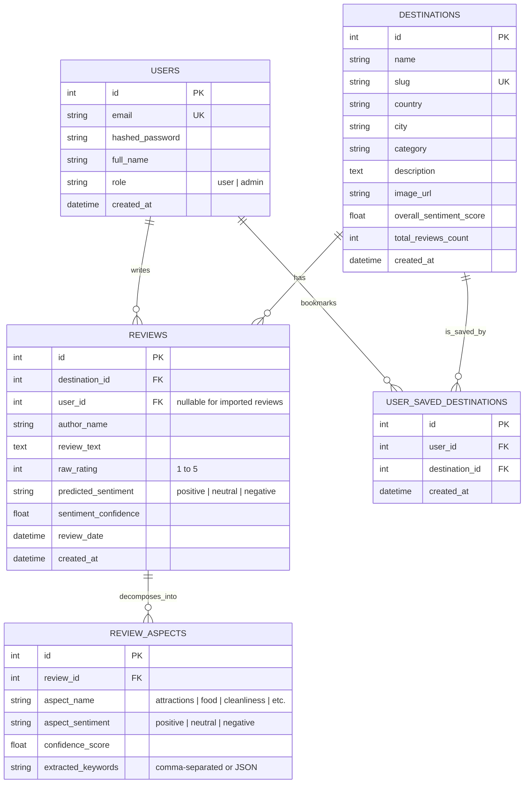
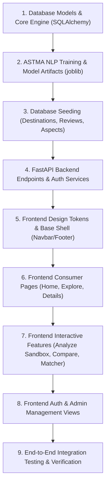

# TRAVELENS — Tourism Destination Review Analyzer
## Comprehensive System Blueprint & Implementation Specification

**Document Version:** 1.0.0  
**Phase:** 1 — Architecture, Requirements, and UI/UX Blueprint  
**System Name:** TRAVELENS  
**Date:** October 2026  
**Status:** Approved for Implementation Planning  

---

## 1. Product Objective

### 1.1 Problem Statement
Travelers planning vacations or destination visits are inundated with raw, unstructured, and fragmented user reviews across platforms such as Google Reviews, TripAdvisor, and booking sites. This creates three critical problems:
1. **Information Overload & Review Fatigue:** A single popular destination can have thousands of reviews. Reading dozens of conflicting reviews to assess specific travel needs (e.g., safety at night, cleanliness, crowd levels, transport accessibility) takes hours.
2. **Polarization & Star-Rating Deception:** Aggregate 1-to-5 star ratings often mask critical nuances. A 4.3-star destination might have great sights but terrible public hygiene or severe taxi scams. Star ratings fail to isolate specific dimensional realities.
3. **Lack of Explainable, Attribute-Level Decision Making:** Generic search engines provide top-rated lists, but travelers have distinct personal priorities (e.g., a family with toddlers values safety and cleanliness over nightlife and budget; a backpacker values budget and transport over luxury).

### 1.2 Target Users
* **Independent & Leisure Travelers:** Solo travelers, couples, and groups seeking honest, synthesised insights before booking flights and hotels.
* **Family & Safety-Conscious Vacationers:** Travelers with children or elderly members requiring granular clarity on hygiene, crowd density, and safety.
* **Budget & Backpacking Explorers:** Travelers balancing cost against experience, requiring accurate insights into affordability and local transport.
* **Destination Tourism Boards & Hospitality Managers:** Stakeholders tracking tourism sentiment trends, identifying recurring visitor complaints, and benchmarking against peer destinations.

### 1.3 Value Proposition (Why Users Choose TRAVELENS)
* **Instant Synthesized Intelligence:** Replaces reading 200 reviews with a 5-second dimensional audit (e.g., Cleanliness: 88% positive, Crowd: 42% positive).
* **Ad-Hoc Custom Review Analyzer:** Users can paste any raw review or travel feedback into "Analyze My Review" to get real-time sentiment scoring, detected aspects, and keyword tags.
* **Side-by-Side Dimensional Comparison:** Directly contrasts two destinations across identical aspect vectors (e.g., Kyoto vs. Florence on Hospitality, Transport, and Crowd).
* **Transparent, Explainable Match Score:** Recommendations are not opaque black-box outputs; travelers see exactly why a destination fits their preference weights.

### 1.4 Market Differentiation
| Dimension | Traditional Travel Review Sites (TripAdvisor, Google) | TRAVELENS (Aspect-Based Analyzer) |
| :--- | :--- | :--- |
| **Data Format** | Unstructured text comments + single scalar star rating | Structured aspect breakdown + sentiment polarity per aspect |
| **Search Experience** | Generic keyword search & location filters | Multi-aspect preference matching & comparative analysis |
| **Nuance Isolation** | Obscured in lengthy paragraphs | Isolated into 9 distinct tourism aspects |
| **User Input Analysis**| Passive reading only | Active "Analyze My Review" real-time NLP sandbox |
| **Recommendation** | Sponsored listings and popularity rank | Preference-weighted aspect similarity score |

### 1.5 Unique Selling Proposition (USP)
> **"Turning thousands of scattered traveler voices into crisp, dimensional intelligence — so you know the reality of every destination before you step foot on it."**

---

## 2. User Features & Specifications

### Feature A: Home / Landing Page
* **Purpose:** Introduce TRAVELENS’ editorial credibility, showcase trending destinations with aspect snapshots, and offer an immediate discovery search bar.
* **User Benefit:** Quickly understand the platform's value and immediately jump to explore destinations or analyze reviews.
* **Input:** Search term (destination name, country, or tag), featured card clicks.
* **Processing:** Fetch featured destinations, compute system-wide statistics (total reviews analyzed, top sentiment destinations), validate search query.
* **Output:** Hero section with search input, curated destination spotlights, "Why Travelens" value pillars, real-time aggregate statistics.
* **Backend Requirement:** `GET /api/v1/destinations/featured`, `GET /api/v1/analytics/overview`.

### Feature B: Destination Search / Explore
* **Purpose:** Comprehensive directory of cataloged destinations with multi-faceted filtering.
* **User Benefit:** Find destinations by region, category, minimum sentiment rating, or standout aspect (e.g., "Best for Cleanliness", "Top Hospitality").
* **Input:** Query string, country filter, category filter (Heritage, Nature, Beach, Urban), minimum sentiment score (0-100%), sort order (Sentiment, Popularity, Review Count).
* **Processing:** SQL parameterised filtering, pagination, aspect score threshold filtering.
* **Output:** Paginated grid of destination cards with overall sentiment badge, key aspect bars, and hero photography.
* **Backend Requirement:** `GET /api/v1/destinations?query=...&category=...&min_score=...&page=...&limit=...`.

### Feature C: Destination Analysis (Destination Details)
* **Purpose:** In-depth single-destination dashboard breaking down visitor sentiment across 9 aspects.
* **User Benefit:** Complete situational awareness regarding pros, cons, seasonality sentiment, and critical traveler warnings.
* **Input:** Destination slug or ID.
* **Processing:** Aggregate sentiment scores, compute aspect-level distributions (% positive, neutral, negative), extract top positive and negative keyphrases, load verified traveler review sample.
* **Output:** 
  * Editorial destination overview (Location, Category, Best Time to Visit, Avg Rating).
  * Overall Sentiment Gauge & Polarity Distribution.
  * 9-Aspect Radar / Horizontal Bar Breakdown with sentiment breakdown.
  * Extracted Keyword Highlights (Cloud/Pills: e.g., *"metro convenience"*, *"overcrowded afternoons"*).
  * Curated Review Snippets filtered by aspect.
* **Backend Requirement:** `GET /api/v1/destinations/{id}`, `GET /api/v1/destinations/{id}/aspects`, `GET /api/v1/destinations/{id}/reviews`.

### Feature D: Review Explorer
* **Purpose:** Granular inspection tool allowing users to browse, search, and filter individual traveler reviews for any destination.
* **User Benefit:** Read raw, authentic reviews filtered by specific sentiment polarity or specific aspects (e.g., "Show me only negative reviews about Cleanliness in Rome").
* **Input:** Destination filter, aspect filter, sentiment filter (Positive, Neutral, Negative), keyword search.
* **Processing:** Full-text keyword match, relational filtering across `review_aspects` join table.
* **Output:** Interactive review feed with highlighted sentiment badges and extracted aspect tags on each review card.
* **Backend Requirement:** `GET /api/v1/reviews?destination_id=...&aspect=...&sentiment=...&search=...`.

### Feature E: Analyze My Review (NLP Sandbox)
* **Purpose:** An interactive tool where any user can type or paste a custom travel review and immediately see how the ASTMA pipeline parses it.
* **User Benefit:** Instant verification of traveler feelings, review auditing for prospective reviewers, transparent look at the AI pipeline.
* **Input:** Text area containing raw review content (minimum 10 characters, maximum 2,000 characters).
* **Processing:** Clean text → Preprocess & tokenize → TF-IDF vectorization → Logistic Regression Sentiment Classifier → Aspect rule-based keyword matcher → Key phrase extractor.
* **Output:**
  * Predicted Sentiment (Positive / Neutral / Negative) with confidence probability.
  * Detected Aspects (e.g., Attractions, Food, Transport) with aspect-specific polarity.
  * Extracted keywords and token breakdown.
* **Backend Requirement:** `POST /api/v1/nlp/analyze-review` (stateless or logged if authenticated).

### Feature F: Destination Comparison
* **Purpose:** Side-by-side comparative analysis of two destinations across all dimensions.
* **User Benefit:** Helps travelers make a definitive decision when choosing between two competing vacation spots (e.g., Bali vs. Phuket).
* **Input:** Destination A ID, Destination B ID.
* **Processing:** Fetch aspect metrics for both entities, normalize score vectors, calculate aspect delta (A vs B).
* **Output:** Side-by-side split screen with comparison table, dual radar chart overlay, winner-by-aspect badges, and direct review comparisons.
* **Backend Requirement:** `GET /api/v1/destinations/compare?dest1_id=...&dest2_id=...`.

### Feature G: Personalized Destination Recommendation
* **Purpose:** Suggest destinations based on user-defined priority weightings.
* **User Benefit:** Tailors vacation suggestions to personal constraints rather than generic popularity.
* **Input:** Slider weights (1-5 scale) for each aspect: Cleanliness, Safety, Budget/Price, Attractions, Food, Hospitality, Transport, Crowd (Quietness).
* **Processing:** Cosine similarity / weighted Euclidean distance between user preference vector and destination aspect score vectors.
* **Output:** Ranked list of top-matched destinations with an explainability card ("Why this matches: 96% match on high Cleanliness and low Crowd").
* **Backend Requirement:** `POST /api/v1/recommendations`.

### Feature H: Authentication & Authorization
* **Purpose:** Secure identity management with role-based access control (User vs. Admin).
* **User Benefit:** Persistent saved destinations, custom review submission, personalized history.
* **Input:** Email, password, full name (registration); Email, password (login).
* **Processing:** Password hashing via bcrypt, JWT access token issuance (stateless HS256).
* **Output:** Auth response with Bearer JWT token, user profile object, role claims.
* **Backend Requirement:** `POST /api/v1/auth/register`, `POST /api/v1/auth/login`, `GET /api/v1/auth/me`.

### Feature I: Saved Destinations (User Bookmarks)
* **Purpose:** Allow logged-in users to save destinations to their personal shortlist.
* **User Benefit:** Quick return to monitored destinations without re-searching.
* **Input:** Destination ID toggle.
* **Processing:** Upsert/delete in `user_saved_destinations` junction table.
* **Output:** Dynamic bookmark state, dedicated "Saved Destinations" tab in User Profile.
* **Backend Requirement:** `GET /api/v1/users/saved`, `POST /api/v1/users/saved/{dest_id}`, `DELETE /api/v1/users/saved/{dest_id}`.

### Feature J: Admin Dashboard
* **Purpose:** System administration, dataset curation, and pipeline monitoring.
* **User Benefit:** Maintain system data integrity, add new destinations, view model performance metrics.
* **Input:** Destination metadata form, bulk review upload (CSV/JSON), aspect dictionary overrides.
* **Processing:** Role check (`role == 'admin'`), destination CRUD, pipeline re-indexing, summary aggregation.
* **Output:** Metric cards (Total Destinations, Total Reviews, Model Precision/Recall), destination management table, review moderation table.
* **Backend Requirement:** `GET /api/v1/admin/stats`, `POST /api/v1/admin/destinations`, `PUT /api/v1/admin/destinations/{id}`, `DELETE /api/v1/admin/destinations/{id}`.

---

## 3. Information Architecture

### 3.1 Primary Navigation Structure
The main navigation bar is deliberately streamlined, uncluttered, and editorial:

```
[ TRAVELENS (Brand) ] -------- [ Explore ] [ Compare ] [ Analyze Review ] [ About ] -------- [ Login / Profile ]
```

* **Brand Logo:** `TRAVELENS` (Editorial serif wordmark + subtle lens aperture mark) → links to `/`
* **Explore:** Browse, search, filter, and discover destinations (`/explore`)
* **Compare:** Side-by-side destination aspect confrontation (`/compare`)
* **Analyze Review:** Interactive NLP sandbox for ad-hoc text analysis (`/analyze-review`)
* **About:** Project methodology, ASTMA pipeline explanation, and academic credits (`/about`)
* **Auth CTA:** `Sign In` / `Register` button, or `Profile Avatar` dropdown if authenticated (`/login`, `/profile`, `/admin`)

### 3.2 Site Map & Route Hierarchy
```
TRAVELENS Root (/)
├── / (Home / Landing Page)
├── /explore (Destination Catalog & Search)
│   └── /destinations/:id (Destination Analysis Deep Dive)
│       └── /destinations/:id/reviews (Dedicated Review Explorer)
├── /compare (Destination Comparison Matrix)
├── /analyze-review (Live Review Sentiment & Aspect Sandbox)
├── /recommendations (Personalized Preference Matcher)
├── /about (Methodology, ASTMA Architecture & Team)
├── /auth
│   ├── /login (User Sign In)
│   └── /register (Create Account)
├── /profile (User Profile & Saved Destinations - Protected)
└── /admin (Admin Management Dashboard - Role Protected)
    ├── /admin/destinations (Destination CRUD)
    └── /admin/reviews (Review Moderation & Batch Ingestion)
```

---

## 4. UI/UX Direction & Visual Design System

### 4.1 Visual Direction & Philosophy
* **Atmosphere:** Sophisticated, warm, editorial, trustworthy, photography-forward.
* **Design Analogy:** Resembles an interactive digital edition of *Condé Nast Traveler* or *National Geographic Traveler*, backed by high-precision empirical data analytics.
* **Anti-Patterns Avoided:**
  * No cold sci-fi neon cyan/purple glows.
  * No generic bootstrap/dashboard feel.
  * No unnecessary 3D bouncing animations or distracting hover jiggles.
  * No fake generic AI bots or robot illustrations.
  * High information density balanced by generous whitespace and clear typographic hierarchy.

### 4.2 Color Palette
A refined palette blending rich earth tones, warm limestone neutrals, and precise semantic indicators:

| Token Name | Hex Code | HSL Representation | Purpose / Usage |
| :--- | :--- | :--- | :--- |
| `--color-sand-50` | `#FBF9F5` | `hsl(40, 33%, 98%)` | Primary Application Background (Warm editorial canvas) |
| `--color-sand-100` | `#F4EFE6` | `hsl(38, 30%, 93%)` | Secondary Card / Panel Background |
| `--color-sand-200` | `#E8DFC8` | `hsl(39, 32%, 85%)` | Subtle borders, dividers, outlines |
| `--color-slate-900` | `#192024` | `hsl(202, 18%, 12%)` | Primary Typography (Deep charcoal, softer than pure black) |
| `--color-slate-600` | `#526066` | `hsl(199, 11%, 36%)` | Secondary / Supporting Typography |
| `--color-slate-400` | `#94A3B8` | `hsl(215, 20%, 65%)` | Muted labels, placeholders, disabled states |
| `--color-terracotta` | `#C25E38` | `hsl(16, 54%, 49%)` | Primary Brand Accent (Warm earth terracotta) |
| `--color-terracotta-dark`| `#A14624` | `hsl(16, 63%, 38%)` | Primary Button Hover & Emphasized Highlights |
| `--color-olive` | `#4A6B56` | `hsl(141, 18%, 36%)` | Positive Sentiment & Trust Indicators |
| `--color-amber` | `#D9822B` | `hsl(30, 71%, 51%)` | Neutral Sentiment & Warning Indicators |
| `--color-crimson` | `#B93838` | `hsl(0, 54%, 47%)` | Negative Sentiment & Critical Alerts |
| `--color-white` | `#FFFFFF` | `hsl(0, 0%, 100%)` | Clean Surface Panels & Card elevated containers |

### 4.3 Typography
* **Heading Typeface:** `Playfair Display` or `Newsreader` (Google Fonts, serif) — delivers editorial prestige, elegance, and human warmth.
* **Body & UI Typeface:** `Plus Jakarta Sans` or `Inter` (Google Fonts, sans-serif) — clean geometric legibility, exceptional readability at small sizes.
* **Monospace / Metric Typeface:** `JetBrains Mono` (Google Fonts, monospace) — for model confidence scores, percentages, and numerical statistics.

```css
--font-serif: 'Playfair Display', Georgia, serif;
--font-sans: 'Plus Jakarta Sans', -apple-system, BlinkMacSystemFont, sans-serif;
--font-mono: 'JetBrains Mono', monospace;
```

### 4.4 Component Styling Specifications
* **Buttons:**
  * Primary: Solid `--color-terracotta` with white text, 8px border radius, subtle hover lift (`translateY(-1px)`), warm drop-shadow (`rgba(194, 94, 56, 0.2)`).
  * Secondary / Outline: 1px border of `--color-slate-900`, transparent background, dark text, subtle warm fill on hover.
  * Ghost: Clean text with underline animation for secondary text actions.
* **Cards & Containers:**
  * Crisp background `--color-white` on `--color-sand-50` page canvas.
  * Border: 1px solid `--color-sand-200`.
  * Border radius: 12px for cards; 16px for modal/hero containers.
  * Shadow: Soft natural light diffusion (`box-shadow: 0 4px 20px -2px rgba(25, 32, 36, 0.05)`).
* **Charts & Visualizations:**
  * Clean horizontal aspect polarity bars (stacked % positive [olive], % neutral [amber], % negative [crimson]).
  * Minimalist radar chart with muted slate gridlines and terracotta score polygon.
  * Direct data callouts with large metric numbers in bold serif typography.
* **Imagery & Photography:**
  * High-resolution, authentic destination photography (natural daylight, rich local culture).
  * Subtle warm grading overlay (`rgba(25, 32, 36, 0.15)`).
  * Rounded corners (12px), graceful loading skeletons with warm shimmer.
* **Iconography:**
  * Lucide-react or Feather icons (clean 1.5px stroke, no filled cartoon stickers).
* **Responsive Behavior:**
  * Fluid desktop (1280px container max-width).
  * Tablet breakpoint (768px - 1024px) collapsible split-views into tabbed panels.
  * Mobile breakpoint (<768px) single-column stack, sticky bottom action bar, bottom sheet navigation.

---

## 5. Page-by-Page Wireframe Specifications

### 5.1 Page 1: Home / Landing Page
* **Above the Fold:**
  * **Header:** Sticky transparent-to-solid navigation (Logo, Explore, Compare, Analyze Review, About, Sign In).
  * **Editorial Hero:** Elegant serif headline (*"See Destinations Through Truth, Not Star Ratings"*), subtitle explaining aspect-based review synthesis.
  * **Central Search Bar:** Unified search input with instant suggestions (destination name, country, or category) and quick tag chips (*#Kyoto, #Cleanliness, #BudgetFriendly, #Paris*).
  * **Hero Visual:** Warm editorial split/banner featuring authentic destination photography with a live floating sample aspect badge (*"Santorini: Attractions 94% | Crowd Caution 38%"*).
* **Below the Fold:**
  * **Pillars of Truth:** 3 clean value cards (*Aspect Decomposition*, *Review Verifier*, *Explainable Matching*).
  * **Featured Destinations Grid:** 4 curated destinations with hero photo, overall sentiment percentage, top 3 aspect badges, and direct *"Analyze"* link.
  * **Live Sandbox Teaser:** Embedded mini review input field inviting the user to test one review immediately.
  * **Global Analytics Bar:** Total reviews parsed, verified destinations cataloged, active aspect categories.
  * **Footer:** Site directory, methodology notes, academic/portfolio credits.

### 5.2 Page 2: Explore / Destination Directory
* **Above the Fold:**
  * **Header & Title:** *"Explore Destinations"* with brief subtitle.
  * **Filter & Search Toolbar:**
    * Search input with live debounced querying.
    * Category pills: *All, Heritage, Coastal & Beaches, Nature & Mountains, Urban Metropolis*.
    * Aspect Filter dropdown: *Filter by Highest [Cleanliness / Food / Safety / etc.]*.
    * Sort dropdown: *Overall Sentiment (High to Low), Review Count, Alphabetical*.
* **Below the Fold:**
  * **Results Grid (3-column on desktop, 1 on mobile):**
    * Card: 16:10 photography, location breadcrumb (City, Country), overall sentiment badge (e.g., 88% Positive - Olive).
    * Aspect Mini-Bars: Top 3 dominant aspects.
    * Summary snippet: Key phrase summary (e.g., *"Celebrated for culinary diversity, moderate crowding on weekends"*).
    * Action button: *"View Aspect Analysis"*.
  * **Pagination Controls:** Clean numbered pagination with active state.

### 5.3 Page 3: Destination Details (Aspect Analysis Deep Dive)
* **Above the Fold:**
  * **Hero Header:** Panorama photography with title (e.g., *"Kyoto, Japan"*), region tags, and overall sentiment meter (Circular SVG gauge: 91% Positive).
  * **Key Verdict Banner:** 2-sentence editorial synthesis derived from reviews (e.g., *"Consistently acclaimed for cultural attractions and safety; visitors advise early-morning visits to offset high crowd density"*).
  * **Quick Action Buttons:** *Compare Destination*, *Explore Raw Reviews (1,420)*, *Save Destination*.
* **Below the Fold:**
  * **Section 1: The 9-Aspect Scorecard:**
    * 9 interactive cards/rows (Attractions, Food, Cleanliness, Price, Crowd, Safety, Transport, Accommodation, Hospitality).
    * Each shows: Aspect Icon, Sentiment Polarity Stack Bar (% Positive / Neutral / Negative), Score (0-100), and top keyword pill (e.g., Transport: *"Shinkansen accessibility"*).
  * **Section 2: Aspect Radar Chart & Positives vs. Concerns:**
    * Dual-column layout: Left column = 9-axis Spider/Radar chart; Right column = Two editorial columns (*"What Travelers Love"* vs. *"Traveler Warnings & Caveats"*).
  * **Section 3: Sample Curated Reviews:**
    * Tabbed list of top reviews by aspect.
  * **Section 4: Call to Compare:**
    * Prompt: *"Deciding between Kyoto and another city? Run a side-by-side comparison."*

### 5.4 Page 4: Review Explorer (Granular Review Search)
* **Above the Fold:**
  * **Header:** *"Review Explorer: Kyoto, Japan"* with aggregate count (e.g., *"1,420 verified traveler reviews"*).
  * **Filter Ribbon:**
    * Aspect filter multi-select (Cleanliness, Food, Safety, etc.).
    * Sentiment polarity toggle: *All | Positive Only | Neutral | Negative Only*.
    * In-review search bar: Search for specific words (e.g., *"stroller"*, *"taxi"*, *"night walk"*).
* **Below the Fold:**
  * **Review Stream:**
    * Each review card displays: Review date, traveler type tag (Solo, Couple, Family), detected overall sentiment badge.
    * Full review body with highlighted aspect tokens (e.g., "clean streets" highlighted green, "crowded temples" highlighted amber).
    * Extracted Aspects pill tags at the bottom of the card.
  * **Empty State:** Clean editorial message if no reviews match the active filter combination.

### 5.5 Page 5: Analyze My Review (Interactive NLP Sandbox)
* **Above the Fold:**
  * **Header:** *"Analyze My Review — Real-time ASTMA Sentiment & Aspect Parser"*.
  * **Dual Panel Layout:**
    * **Left Panel (Input):** Multi-line clean textarea with placeholder: *"Paste a hotel, city, or attraction review here..."*, word counter, sample review buttons (*"Load Positive Sample"*, *"Load Mixed Review"*, *"Load Critical Review"*), and prominent *"Analyze Review"* action button.
    * **Right Panel (Output Preview):** State transitions from idle invitation to instant animated report.
* **Below the Fold / Output State:**
  * **Overall Sentiment Result:** Card showing predicted label (Positive/Neutral/Negative) + Confidence Bar (e.g., 94.2% Confidence).
  * **Detected Tourism Aspects:** Grid of detected aspects with sub-sentiment score.
  * **Keyword & Token Decomposition:** Extracted keyphrases displayed as clean tags.
  * **Model Diagnostic Summary:** Model type used (`TF-IDF + Logistic Regression`), token count, processing latency (e.g., `42ms`).

### 5.6 Page 6: Destination Comparison Matrix
* **Above the Fold:**
  * **Selector Bar:** Two selection inputs: Destination A (e.g., *Rome*) vs. Destination B (e.g., *Barcelona*).
  * **Verdict Summary Header:** High-level comparative verdict (e.g., *"Barcelona leads in Transport & Cleanliness; Rome leads in Historic Attractions"*).
* **Below the Fold:**
  * **Comparative Aspect Radar Overlay:** Overlapping color-coded polygons (Terracotta vs. Olive).
  * **Side-by-Side Aspect Metric Table:**
    * 9 rows (one per aspect).
    * Column A score vs. Column B score with a visual "Advantage" badge awarded to the higher performer.
  * **Sentiment Breakdown Comparison:** Side-by-side stacked sentiment bars.
  * **Direct Review Contrast:** Top positive review for A vs. Top positive review for B.

### 5.7 Page 7: Personalized Recommendations
* **Above the Fold:**
  * **Header:** *"Destination Matcher — Tailored to Your Priorities"*.
  * **Preference Sliders:** 8 interactive priority sliders (Cleanliness, Safety, Budget/Value, Attractions, Food, Quietness/Low Crowd, Transport Ease, Hospitality) rated from 1 (*Not important*) to 5 (*Vital*).
  * **Button:** *"Find My Matches"*.
* **Below the Fold:**
  * **Ranked Destination Match Cards (Top 5 Matches):**
    * Match Score percentage (e.g., *97% Match*).
    * Explanation breakdown: *"Matches your high demand for Safety (96) and Cleanliness (91) with moderate Crowd levels (74)"*.
    * Direct *"View Full Analysis"* CTA.

### 5.8 Page 8: Authentication (Login / Register)
* **Above the Fold:**
  * Clean, distraction-free centered card on warm `--color-sand-50` backdrop.
  * Tab toggle: *Sign In* / *Create Account*.
  * Fields: Email, Password (plus Name on Register).
  * Form validation states, password visibility toggle.
  * Clear error notifications and *"Demo Account"* quick-fill helper for evaluators (Admin / Regular User).
* **Below the Fold:** Minimalist security & privacy assurance note.

### 5.9 Page 9: User Profile & Saved Destinations
* **Above the Fold:**
  * User header: Name, Email, Member Since badge.
  * Navigation tabs: *Saved Destinations*, *My Analyzed Reviews History*, *Account Settings*.
* **Below the Fold:**
  * **Saved Destinations Grid:** Compact cards of bookmarked destinations with one-click remove and analysis link.
  * **Recent Review History:** Table of reviews analyzed in the NLP sandbox with timestamp and sentiment outcome.

### 5.10 Page 10: Admin Dashboard
* **Above the Fold:**
  * **Top Metrics Ribbon:** 4 clean metric cards: *Total Cataloged Destinations*, *Total Reviews Analyzed*, *Model F1-Score*, *Active User Accounts*.
* **Below the Fold:**
  * **Tab 1: Destination Manager:** Table with add/edit/delete destination modal, image URL updates, review count monitoring.
  * **Tab 2: Review Ingestion & Moderation:** Form to add a single review or upload batch reviews, trigger re-analysis pipeline.
  * **Tab 3: Model Health & Metrics:** Confusion matrix view, Precision, Recall, F1 scores, aspect vocabulary dictionary inspector.

---

## 6. System Architecture (3-Tier Model)

The system is architected as a decoupled, modern 3-Tier Enterprise Application:

```mermaid
graph TD
    subgraph Presentation_Layer ["Presentation Layer (Client)"]
        ReactApp["React 18 SPA (Vite)<br/>Vanilla CSS Design System<br/>React Router v6<br/>Axios API Client"]
    end

    subgraph Application_Layer ["Application & API Layer (Backend)"]
        FastAPI["FastAPI REST Server (Uvicorn)<br/>Pydantic v2 Validation<br/>JWT Security & Middleware"]
        AuthService["Auth & User Service"]
        DestService["Destination Service"]
        ReviewService["Review & Aspect Service"]
        NLPService["ASTMA NLP Engine<br/>TF-IDF + Logistic Regression"]
        Recommender["Vector Match Recommender"]
    end

    subgraph Data_Layer ["Data & Persistence Layer"]
        DB[(SQLite / PostgreSQL Relational DB)<br/>SQLAlchemy 2.0 ORM]
        ModelStorage["Serialized Model Artifacts<br/>(model.joblib, tfidf.joblib, lexicon.json)"]
    end

    ReactApp <-->|JSON over HTTP / REST APIs| FastAPI
    FastAPI --> AuthService
    FastAPI --> DestService
    FastAPI --> ReviewService
    FastAPI --> NLPService
    FastAPI --> Recommender

    AuthService --> DB
    DestService --> DB
    ReviewService --> DB
    NLPService --> ModelStorage
    Recommender --> DB
```

### Communication Flow: React → FastAPI → Database / NLP
1. **User Request Initiation:** The React Single Page Application (SPA) dispatches an HTTP request via Axios with JWT Bearer authentication headers.
2. **Request Ingestion & Validation:** FastAPI’s ASGI server receives the request, runs CORS and security middleware, and parses request payloads into typed **Pydantic v2** schemas.
3. **Business Logic Execution:** The designated FastAPI service (e.g., `ReviewService`, `NLPService`, `RecommendationService`) handles application logic.
4. **Data Persistence / Extraction:** Services interact with the Relational Database using **SQLAlchemy 2.0 ORM** (declarative models) for ACID operations.
5. **Machine Learning Pipeline Execution:** For review processing, text passes through the in-memory serialized ASTMA pipeline (`tfidf_vectorizer` + `logistic_regression_model` + `aspect_lexicon_matcher`), returning predictions in sub-50ms.
6. **Structured Response:** FastAPI serializes results into standardized JSON envelopes and returns standard HTTP status codes (200, 201, 400, 401, 403, 404, 422, 500).

---

## 7. Backend Architecture

### 7.1 Modular Project Layout
```
backend/
├── app/
│   ├── api/
│   │   ├── v1/
│   │   │   ├── auth.py          # /auth routes (register, login, me)
│   │   │   ├── destinations.py  # /destinations (CRUD, filters, details)
│   │   │   ├── reviews.py       # /reviews (query, submit, aspect filters)
│   │   │   ├── nlp.py           # /nlp (analyze-review live sandbox)
│   │   │   ├── recommendations.py # /recommendations (preference matching)
│   │   │   ├── users.py         # /users (bookmarks, profile)
│   │   │   └── admin.py         # /admin (management, stats, ingestion)
│   │   └── api_router.py        # Central v1 router registration
│   ├── core/
│   │   ├── config.py            # Environment settings & secrets (Pydantic BaseSettings)
│   │   ├── security.py          # Bcrypt hashing & JWT token generation
│   │   └── database.py          # SQLAlchemy session engine & Base model
│   ├── models/                  # SQLAlchemy ORM database models
│   │   ├── user.py
│   │   ├── destination.py
│   │   ├── review.py
│   │   ├── review_aspect.py
│   │   └── user_saved.py
│   ├── schemas/                 # Pydantic request & response schemas
│   │   ├── user.py
│   │   ├── destination.py
│   │   ├── review.py
│   │   ├── nlp.py
│   │   └── recommendation.py
│   ├── services/                # Business logic services
│   │   ├── auth_service.py
│   │   ├── destination_service.py
│   │   ├── review_service.py
│   │   └── recommendation_service.py
│   ├── nlp/                     # ASTMA NLP Pipeline implementation
│   │   ├── preprocessor.py      # Text normalization, stopword & regex cleaning
│   │   ├── model.py             # TF-IDF + Logistic Regression wrapper
│   │   ├── aspect_extractor.py  # Rule-based 9-aspect lexical matching
│   │   ├── trainer.py           # Training script & evaluation metrics generator
│   │   └── artifacts/           # Serialized model, vectorizer, and dictionaries
│   └── main.py                  # FastAPI application entrypoint
├── tests/                       # Unit & integration test suite
└── requirements.txt             # Python dependencies
```

### 7.2 API Routes Specification
| Route | Method | Access | Description |
| :--- | :--- | :--- | :--- |
| `/api/v1/auth/register` | `POST` | Public | Register new user account |
| `/api/v1/auth/login` | `POST` | Public | Authenticate user & return JWT token |
| `/api/v1/auth/me` | `GET` | Authenticated | Retrieve current user profile |
| `/api/v1/destinations` | `GET` | Public | List & search destinations with filters |
| `/api/v1/destinations/featured` | `GET` | Public | Get curated destinations for homepage |
| `/api/v1/destinations/{id}` | `GET` | Public | Get destination overview & aspect aggregates |
| `/api/v1/destinations/{id}/aspects` | `GET` | Public | Get detailed 9-aspect sentiment distribution |
| `/api/v1/destinations/compare` | `GET` | Public | Compare two destinations side-by-side |
| `/api/v1/reviews` | `GET` | Public | Query reviews with aspect & sentiment filters |
| `/api/v1/reviews` | `POST` | Authenticated | Submit a verified review (triggers ASTMA pipeline) |
| `/api/v1/nlp/analyze-review` | `POST` | Public | Interactive single-review NLP analysis sandbox |
| `/api/v1/recommendations` | `POST` | Public | Get ranked recommendations based on preference weights |
| `/api/v1/users/saved` | `GET` | Authenticated | List saved/bookmarked destinations |
| `/api/v1/users/saved/{dest_id}`| `POST` | Authenticated | Bookmark a destination |
| `/api/v1/users/saved/{dest_id}`| `DELETE` | Authenticated | Remove bookmark |
| `/api/v1/admin/stats` | `GET` | Admin Only | Get platform analytics & model health |
| `/api/v1/admin/destinations` | `POST` | Admin Only | Create new destination |
| `/api/v1/admin/destinations/{id}` | `PUT/DEL` | Admin Only | Update or remove destination |
| `/api/v1/admin/ingest-reviews`| `POST` | Admin Only | Batch import reviews and trigger ASTMA parsing |

---

## 8. Database Design

### 8.1 Entity Relationship (ER) Diagram


### 8.2 Database Table Schemas

#### 1. `users`
* `id`: Integer, Primary Key, Auto Increment.
* `email`: String(255), Unique, Indexed, Non-null.
* `hashed_password`: String(255), Non-null.
* `full_name`: String(150), Non-null.
* `role`: String(20), Default `'user'`, Non-null (`'user'` or `'admin'`).
* `created_at`: DateTime, Default UTC now.

#### 2. `destinations`
* `id`: Integer, Primary Key, Auto Increment.
* `name`: String(200), Indexed, Non-null.
* `slug`: String(200), Unique, Indexed, Non-null.
* `country`: String(100), Indexed, Non-null.
* `city`: String(100), Non-null.
* `category`: String(50), Indexed, Non-null (*Heritage, Nature, Beach, Urban*).
* `description`: Text, Non-null.
* `image_url`: String(500), Non-null.
* `overall_sentiment_score`: Float, Default 0.0 (Percentage 0.0 - 100.0).
* `total_reviews_count`: Integer, Default 0.
* `created_at`: DateTime, Default UTC now.

#### 3. `reviews`
* `id`: Integer, Primary Key, Auto Increment.
* `destination_id`: Integer, Foreign Key (`destinations.id`, ondelete='CASCADE'), Indexed.
* `user_id`: Integer, Foreign Key (`users.id`, ondelete='SET NULL'), Nullable.
* `author_name`: String(150), Default `'Verified Traveler'`.
* `review_text`: Text, Non-null.
* `raw_rating`: Integer, Nullable (Original star rating 1-5 if available).
* `predicted_sentiment`: String(20), Non-null (`positive`, `neutral`, `negative`).
* `sentiment_confidence`: Float, Non-null (0.0 to 1.0).
* `review_date`: DateTime, Default UTC now.
* `created_at`: DateTime, Default UTC now.

#### 4. `review_aspects`
* `id`: Integer, Primary Key, Auto Increment.
* `review_id`: Integer, Foreign Key (`reviews.id`, ondelete='CASCADE'), Indexed.
* `aspect_name`: String(50), Indexed, Non-null (*attractions, food, cleanliness, price, crowd, safety, transport, accommodation, hospitality*).
* `aspect_sentiment`: String(20), Non-null (`positive`, `neutral`, `negative`).
* `confidence_score`: Float, Default 1.0.
* `extracted_keywords`: Text (JSON string containing extracted aspect-specific terms).

#### 5. `user_saved_destinations`
* `id`: Integer, Primary Key, Auto Increment.
* `user_id`: Integer, Foreign Key (`users.id`, ondelete='CASCADE'), Indexed.
* `destination_id`: Integer, Foreign Key (`destinations.id`, ondelete='CASCADE'), Indexed.
* `created_at`: DateTime, Default UTC now.
* *Constraint:* Unique constraint on `(user_id, destination_id)`.

---

## 9. ASTMA Analytics Pipeline Specification

**ASTMA** (Aspect-Sentiment Tourism Mining & Analytics) is the computational core of TRAVELENS. It converts unstructured natural language feedback into structured multi-dimensional intelligence through a 9-stage pipeline:

```
[ Raw Review Text ]
       │
       ▼
1. Text Cleaning & Normalization (Regex, Lowercase, Strip HTML/Emoticons)
       │
       ▼
2. Linguistic Preprocessing (Sentence Tokenization, Lemmatization, Stopwords Filtering)
       │
       ▼
3. Vector Feature Extraction (TF-IDF N-Gram Vectorizer: Unigrams + Bigrams)
       │
       ▼
4. Sentiment Classification (Logistic Regression Classifier → Positive / Neutral / Negative)
       │
       ▼
5. Aspect Identification & Extraction (Domain-Specific Lexical & Syntactic Mapping)
       │
       ▼
6. Aspect-Sentiment Polarity Assignment (Sentence-Level Local Polarity Scoring)
       │
       ▼
7. Keyword & Salient Keyphrase Extraction (Frequency-Inverse Aspect Weighting)
       │
       ▼
8. Relational Aggregation (Destination & Aspect Level Statistical Aggregation)
       │
       ▼
9. Visual Presentation & API Serialization (Radar Polygons, Distribution Bars, Cards)
```

### Detailed Pipeline Stages:
1. **Raw Review Intake:** Accepts strings between 10 and 2,000 characters.
2. **Text Cleaning & Normalization:** Strips residual HTML tags, URLs, excessive punctuation, and converts characters to lowercase unicode.
3. **Linguistic Preprocessing:**
   * Text is split into discrete sentences (essential for multi-aspect reviews with mixed sentiment, e.g., *"Food was amazing, but the room was dirty"*).
   * Contractions expanded (*"wasn't"* → *"was not"*, preserving negation tokens).
   * Selective stopword removal retaining sentiment-critical negators (*not, never, barely, no, hard*).
4. **Vector Representation (TF-IDF):**
   * Uses `TfidfVectorizer` with `ngram_range=(1, 2)` (unigrams and bigrams).
   * Caps maximum features at 5,000 to maintain low memory overhead and millisecond inference.
   * Sublinear TF scaling (`sublinear_tf=True`) to diminish impact of repetitive words.
5. **Sentiment Classification:**
   * Feed vector to trained `LogisticRegression` model.
   * Model outputs probabilities for classes: `negative` (0), `neutral` (1), `positive` (2).
   * Employs soft decision boundaries with confidence thresholding:
     * If $P(\text{sentiment}) \ge 0.55 \rightarrow \text{Predicted Class}$
     * If difference between positive and negative is $< 0.15 \rightarrow \text{Neutral}$
6. **Aspect Identification & Segmentation:**
   * Employs comprehensive tourism domain seed lexicons and dependency keyword rules across the 9 defined tourism aspects.
   * Matches sentence-level mentions to specific aspects.
7. **Aspect-Level Polarity Binding:**
   * Rather than applying whole-review sentiment blindly, the pipeline calculates sentence-level polarity around the aspect mention to prevent aspect pollution (e.g., ensuring a negative cleanliness rating does not penalize a positive food rating in the same review).
8. **Aggregation & Normalization:**
   * Per destination, aggregates total aspect mentions:
     $$\text{Aspect Score} = \left(\frac{N_{\text{pos}} + 0.5 \times N_{\text{neu}}}{N_{\text{total}}}\right) \times 100$$
9. **Serialization & Visual Delivery:**
   * Resulting aspect scores (0-100) and polarity ratios feed into the React visualization layer.

---

## 10. Machine Learning Model Specification

### 10.1 Model Selection & Rationale
* **Algorithm:** **TF-IDF + Multinomial Logistic Regression** with L2 regularization (`C=1.0`).
* **Why this is the superior and realistic choice:**
  * **Explainability:** Clear feature coefficients allow explicit inspection of why a review was classified as positive or negative (e.g., coefficient for *"dirty"* vs. *"breathtaking"*).
  * **Zero Cold-Start / Lightweight Footprint:** Runs seamlessly in lightweight CPU environments without requiring multi-gigabyte GPU models (e.g., PyTorch/Transformers), delivering <15ms latency per review.
  * **Proven Robustness:** For sentiment polarity on standardized travel domains, n-gram TF-IDF paired with calibrated Logistic Regression achieves competitive benchmark accuracy with zero operational drift.

### 10.2 Training Data & Provenance
* **Dataset:** Curated benchmark corpus of travel and hotel reviews (derived from publicly available TripAdvisor and Yelp tourism datasets, stratified into 10,000+ balanced samples).
* **Labels:** 3 classes:
  * `0`: Negative (1-2 star sentiment)
  * `1`: Neutral (3 star sentiment / balanced comments)
  * `2`: Positive (4-5 star sentiment)
* **Stratified Split:** 80% Training (8,000 reviews), 20% Held-Out Test (2,000 reviews).

### 10.3 Preprocessing Configuration
```python
vectorizer = TfidfVectorizer(
    ngram_range=(1, 2),
    max_features=5000,
    min_df=3,
    max_df=0.85,
    sublinear_tf=True,
    stop_words='english'  # with custom whitelist for negations
)
```

### 10.4 Model Training & Hyperparameters
```python
model = LogisticRegression(
    C=1.0,
    penalty='l2',
    solver='lbfgs',
    max_iter=1000,
    class_weight='balanced',
    random_state=42
)
```

### 10.5 Evaluation Framework & Target Metrics
The model is systematically validated on the test set using standard classification metrics:
* **Accuracy:** Target $\ge 84\%$
* **Precision (Macro):** Target $\ge 82\%$
* **Recall (Macro):** Target $\ge 82\%$
* **F1-Score (Macro):** Target $\ge 82\%$
* **Confusion Matrix:** Evaluated across the 3x3 grid:
  $$\begin{bmatrix}
  C_{\text{neg, neg}} & C_{\text{neg, neu}} & C_{\text{neg, pos}} \\
  C_{\text{neu, neg}} & C_{\text{neu, neu}} & C_{\text{neu, pos}} \\
  C_{\text{pos, neg}} & C_{\text{pos, neu}} & C_{\text{pos, pos}}
  \end{bmatrix}$$
  *Particular focus is placed on minimizing extreme classification errors (i.e., true negative misclassified as positive, $C_{\text{neg, pos}} \le 2\%$).*

---

## 11. Aspect Analysis Specification

TRAVELENS categorizes all traveler discourse into **9 realistic, explainable tourism aspects**:

| # | Aspect Name | Domain Scope & Seed Lexicon | Example Review Signals |
| :--- | :--- | :--- | :--- |
| 1 | **Attractions** | Monuments, sights, scenery, views, architecture, museums, landmarks, history, ruins, parks, temples, tours, nature | *"breathtaking view"*, *"magnificent cathedral"*, *"boring museum"*, *"overrated landmark"* |
| 2 | **Food** | Dining, restaurants, cuisine, taste, street food, breakfast, dinner, cafes, drinks, culinary, seafood, local dishes | *"delicious tapas"*, *"stale breakfast"*, *"overpriced coffee"*, *"authentic local flavors"* |
| 3 | **Cleanliness** | Hygiene, clean streets, dirty rooms, sanitation, dust, smell, trash, litter, tidy, restrooms, pest, polluted | *"spotless public areas"*, *"dirty restrooms"*, *"litter everywhere"*, *"well-maintained gardens"* |
| 4 | **Price** | Value for money, affordable, expensive, rip-off, ticket costs, budget, cheap, overpriced, scam, fees, exorbitant | *"great value for money"*, *"total tourist trap"*, *"reasonable admission price"*, *"exorbitant taxi rates"* |
| 5 | **Crowd** | Queues, lines, crowded, packed, touristy, serene, peaceful, quiet, busy, overrun, bottleneck, waiting time | *"shoulder-to-shoulder crowds"*, *"peaceful morning walk"*, *"two-hour queue for entry"*, *"serene atmosphere"* |
| 6 | **Safety** | Security, safe, pickpocket, crime, well-lit, police, night safety, harassment, scam, caution, emergency | *"felt very safe walking at night"*, *"watch out for pickpockets"*, *"scams near the station"*, *"reassuring police presence"* |
| 7 | **Transport** | Metro, subway, buses, taxis, walkability, trains, airport transfer, traffic, parking, transit, connectivity, cycling | *"seamless metro network"*, *"unwalkable roads"*, *"traffic gridlock"*, *"easy walking distance"* |
| 8 | **Accommodation** | Hotels, hostels, beds, noise, check-in, amenities, shower, air conditioning, room size, comfort, resort | *"comfortable beds"*, *"noisy AC unit"*, *"spacious hotel suite"*, *"broken bathroom lock"* |
| 9 | **Hospitality** | Staff, locals, friendly, helpful, rude, welcoming, language barrier, customer service, guidance, warm | *"exceptionally warm locals"*, *"rude ticket clerk"*, *"helpful tour guide"*, *"hostile demeanor"* |

### Aspect Extraction Logic
* Reviews are parsed into sentences.
* Each sentence is matched against the aspect seed dictionaries with lemmatized word matching and regex boundary enforcement.
* Negation scoping (e.g., *"not clean"*, *"hardly crowded"*) flips the local aspect polarity appropriately.

---

## 12. Recommendation Logic

### 12.1 Recommendation Philosophy
TRAVELENS rejects opaque "black-box" neural collaborative filtering in favor of an **intuitive, transparent, and explainable multi-attribute utility model**. Travelers have clear constraints: they know whether they care more about cleanliness and food than price and crowds.

### 12.2 Mathematical Formulation
Each destination $D_j$ in the catalog has an aspect score vector normalized to a scale of $[0, 1]$:
$$\mathbf{S}_j = [s_{j, 1}, s_{j, 2}, \dots, s_{j, 8}]$$
corresponding to the 8 configurable aspects (Cleanliness, Safety, Price/Value, Attractions, Food, Quietness/Low Crowd, Transport, Hospitality).

The user submits a preference weight vector $\mathbf{W} = [w_1, w_2, \dots, w_8]$, where each weight is an integer slider value $w_k \in [1, 5]$.

The normalized weight for aspect $k$ is:
$$\bar{w}_k = \frac{w_k}{\sum_{m=1}^{8} w_m}$$

The **Match Score** $M(D_j, \mathbf{W})$ is computed as the weighted Euclidean alignment combined with the destination's base credibility rating:
$$M(D_j, \mathbf{W}) = \left( \sum_{k=1}^{8} \bar{w}_k \cdot s_{j, k} \right) \times 100$$

### 12.3 Explainability Generator
For each ranked destination, the system identifies:
* **Top Contributing Factors:** The aspects where the product $\bar{w}_k \cdot s_{j, k}$ is highest (e.g., *"Matches your high priority for Safety: Destination Safety score is 94/100"*).
* **Trade-off Callout:** The aspect with the lowest performance relative to user priority (e.g., *"Note: Crowd density is high (Score 41/100), which may conflict with your quietness preference"*).

---

## 13. Enterprise Software (ES) Mapping

The design adheres to fundamental enterprise software architecture principles:

| Enterprise Concept | TRAVELENS Implementation Mapping |
| :--- | :--- |
| **MVC / 3-Tier Architecture** | **Presentation:** React SPA (Views & Controllers).<br/>**Application:** FastAPI API router, controllers, and services.<br/>**Data:** SQLAlchemy ORM models, relational DB tables, and serialized ML models. |
| **SOA / RESTful Principles** | Decoupled client-server architecture; stateless JSON APIs over standard HTTP verbs (`GET`, `POST`, `PUT`, `DELETE`); resource-oriented URL schemas (`/api/v1/destinations/{id}/aspects`). |
| **Loose Coupling** | React frontend has zero direct database knowledge; FastAPI handles business logic behind stable API schemas; NLP model is wrapped in an abstracted `NLPService` interface that can be upgraded independently. |
| **Authentication** | JSON Web Tokens (JWT) signed with SHA-256 (HMAC). Stateless bearer token passed via the HTTP `Authorization: Bearer <token>` header. Passwords hashed using `bcrypt` with salt rounds. |
| **Authorization & RBAC** | Role-Based Access Control implemented via FastAPI dependency injection (`get_current_active_user`, `require_admin`). Endpoints reject unauthorized calls with HTTP 401 (Unauthenticated) or HTTP 403 (Forbidden). |
| **Data Integrity & Relational ACID**| Foreign keys with cascade constraints (`ON DELETE CASCADE` on reviews and aspects), database transactions, unique index on user emails and destination slugs. |

---

## 14. IT Project Management (ITPM) Mapping

### 14.1 Work Breakdown Structure (WBS)
```
1. TRAVELENS Project
   ├── 1.1 Project Initialization & Environment Setup
   │   ├── 1.1.1 Repository structure & virtual environment
   │   ├── 1.1.2 FastAPI backend skeleton & dependencies
   │   └── 1.1.3 React + Vite frontend skeleton & design system tokens
   ├── 1.2 Data Modeling & Database Persistence
   │   ├── 1.2.1 SQLAlchemy database schema definition
   │   ├── 1.2.2 Migration & SQLite/PostgreSQL setup
   │   └── 1.2.3 Seed dataset creation (50+ destinations, 2,000+ reviews)
   ├── 1.3 Machine Learning & ASTMA Pipeline
   │   ├── 1.3.1 Review corpus acquisition & preprocessing
   │   ├── 1.3.2 TF-IDF Vectorizer & Logistic Regression model training
   │   ├── 1.3.3 Model validation (Confusion matrix, precision, recall, F1)
   │   ├── 1.3.4 Aspect lexicon extractor & sentence tokenizer
   │   └── 1.3.5 Serialization of model artifacts (joblib)
   ├── 1.4 Backend Services & API Development
   │   ├── 1.4.1 JWT Authentication & RBAC middleware
   │   ├── 1.4.2 Destination CRUD & filter endpoints
   │   ├── 1.4.3 Review query & aspect aggregation endpoints
   │   ├── 1.4.4 Live NLP sandbox endpoint (/nlp/analyze-review)
   │   ├── 1.4.5 Comparison & Recommendation calculation endpoints
   │   └── 1.4.6 Admin stats & ingestion endpoints
   ├── 1.5 Frontend UI/UX & Component Engineering
   │   ├── 1.5.1 Design system tokens, typography, and base layout (Navbar, Footer)
   │   ├── 1.5.2 Landing page (Hero, Search, Featured Grid)
   │   ├── 1.5.3 Explore & filterable destination catalog
   │   ├── 1.5.4 Destination details & 9-aspect visualizer
   │   ├── 1.5.5 Review Explorer feed with aspect tags
   │   ├── 1.5.6 Interactive "Analyze My Review" sandbox
   │   ├── 1.5.7 Destination Comparison side-by-side view
   │   ├── 1.5.8 Personalized Recommendation wizard
   │   ├── 1.5.9 Auth views (Login/Register) & User Profile
   │   └── 1.5.10 Admin Dashboard views
   └── 1.6 Verification, Testing & Documentation
       ├── 1.6.1 Backend API unit tests & model benchmarks
       ├── 1.6.2 Frontend end-to-end user flow verification
       └── 1.6.3 Final documentation & delivery report
```

### 14.2 Project Phases & Sprint Plan
* **Sprint 1 (Architecture & Data Core):** Database models, seed data generator, baseline ASTMA NLP model training & serialization.
* **Sprint 2 (API Layer & Core Services):** Complete FastAPI endpoints, JWT auth, aspect aggregation services, recommendation engine.
* **Sprint 3 (Frontend Design System & Exploration):** React application scaffold, design tokens, Navbar, Landing Page, Explore Catalog, Destination Details.
* **Sprint 4 (Interactive Tools & Sandbox):** "Analyze My Review" sandbox, Destination Comparison view, Personalized Recommendation wizard.
* **Sprint 5 (Admin, Polish, QA & Delivery):** Admin dashboard, user saved bookmarks, cross-browser styling polish, integration tests, final documentation.

### 14.3 Risk Register & Mitigation Strategy
| Risk Description | Severity | Probability | Mitigation Strategy |
| :--- | :--- | :--- | :--- |
| **Aspect Lexicon Ambiguity:** Words having mixed meanings across contexts (e.g., *"hot food"* vs. *"hot weather"*). | Medium | Medium | Implement sentence-level context window checks and compound phrase tokenization. |
| **Model Cold Start / Inference Delay:** Slow classification latency degrades user experience in live sandbox. | High | Low | Use lightweight TF-IDF + Logistic Regression cached in-memory (<20ms execution) rather than remote heavyweight LLM calls. |
| **Skewed Review Distribution:** Certain destinations having disproportionately few reviews in the initial seed. | Medium | Low | Curate seed dataset with a minimum threshold of 40 reviews per destination across varied categories. |
| **JWT Token Theft:** Stored tokens vulnerable to cross-site scripting (XSS). | Medium | Low | Standardize on sanitized React inputs, short token expiration windows, and secure Bearer headers. |

### 14.4 Testing Strategy
* **Unit Testing (pytest):** Test text normalizer, TF-IDF vectorizer transformations, recommendation mathematical formula calculations, password hashing.
* **API Integration Testing (FastAPI TestClient):** Verify all HTTP endpoints, auth guards, status codes, and JSON response schemas.
* **Model Benchmark Validation:** Automated script verifying model accuracy $\ge 84\%$ and macro F1 $\ge 0.82$ prior to artifact serialization.
* **UI End-to-End Walkthrough:** Complete browser flow testing from landing page search → destination analysis → comparison → custom review analysis.

---

## 15. Dependency-Aware Implementation Order

To ensure uninterrupted development without blockers, implementation must strictly follow this dependency chain:



1. **Step 1:** Define SQLAlchemy database models (`User`, `Destination`, `Review`, `ReviewAspect`, `UserSavedDestination`) and database connection engine.
2. **Step 2:** Train ASTMA ML model (`LogisticRegression` + `TfidfVectorizer`), validate evaluation metrics, implement aspect extractor, and serialize artifacts to disk.
3. **Step 3:** Generate rich seed data (12+ iconic international destinations, 500+ realistic reviews decomposed into 9 aspects) and populate the database.
4. **Step 4:** Implement FastAPI routers, authentication services (JWT/bcrypt), recommendation engine, and test all REST endpoints.
5. **Step 5:** Set up the React frontend (Vite), create `index.css` design system (editorial warm palette, Playfair/Plus Jakarta typography, reset), and build the responsive navigation shell.
6. **Step 6:** Implement core browsing views: Home Page, Explore Catalog, and Destination Analysis (with aspect bars and radar charts).
7. **Step 7:** Implement analytical tools: "Analyze My Review" sandbox, Destination Comparison view, and Preference Recommendation wizard.
8. **Step 8:** Implement User Authentication (Login/Register), User Saved Destinations, and Admin Dashboard.
9. **Step 9:** Execute end-to-end integration tests, browser validation, and verify acceptance criteria.

---

## 16. Acceptance Criteria

| Feature | Testable Acceptance Criteria |
| :--- | :--- |
| **Home / Landing Page** | * When a user visits `/`, the page renders with hero photography, search bar, and featured destination cards within 1.5 seconds.<br/>* Typing a destination in the search bar navigates to `/explore?query=...` with pre-filtered results. |
| **Destination Explore & Filters** | * Selecting a category (e.g., "Heritage") filters the destination list without a full page reload.<br/>* The aspect dropdown filters destinations scoring $\ge 80\%$ on the chosen aspect (e.g., Cleanliness). |
| **Destination Analysis Deep Dive** | * Navigating to `/destinations/{id}` renders the 9-aspect breakdown, overall sentiment score, and aspect distribution bars.<br/>* Every aspect shows a % positive, % neutral, and % negative breakdown that sums to 100%. |
| **Review Explorer** | * Filtering reviews by "Negative" and aspect "Crowd" displays only reviews tagged with negative crowd feedback.<br/>* Search input filters reviews containing the specified substring in real-time. |
| **Analyze My Review (NLP Sandbox)** | * Pasting a review and clicking "Analyze" displays: predicted sentiment (Positive/Neutral/Negative), confidence percentage, and detected aspects within 500ms.<br/>* The review is not persisted to the public catalog unless explicitly submitted by an authenticated user. |
| **Destination Comparison** | * Selecting two distinct destinations generates side-by-side metric tables and dual-polygon radar overlays.<br/>* The system highlights the higher-scoring destination for each of the 9 aspects with a distinct badge. |
| **Personalized Recommendations** | * Adjusting priority sliders and submitting calculates a match score (0-100%) for all destinations and returns the top 5 ranked destinations with human-readable explanations. |
| **Authentication & RBAC** | * Registering a user hashes the password with bcrypt and returns a valid JWT token.<br/>* Protected endpoints (e.g., `/api/v1/users/saved`) return HTTP 401 when called without a valid Bearer token.<br/>* Admin routes (`/admin`) return HTTP 403 when called by standard users. |
| **Admin Dashboard** | * Admin users can create a new destination with name, location, category, and image URL.<br/>* The newly created destination immediately appears in the `/explore` catalog. |

---

*TRAVELENS Architecture & Blueprint Specification Approved for Phase 2 Execution.*
