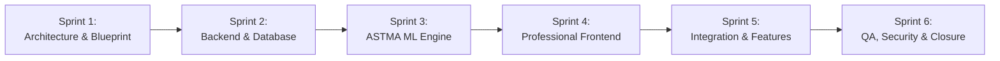

# AGILE_SPRINT_PLAN.md — Agile Delivery & Sprint Execution Plan

**Project Name:** TRAVELENS — Tourism Destination Review Analyzer  
**Academic Module:** IT Project Management (ITPM)  
**Methodology:** Iterative Agile / Sprint-Based Engineering Process  
*Note: Ceremonies and workflows reflect the project's phased engineering execution and sprint milestones.*

---

## 1. Agile Framework & Philosophy

The development of TRAVELENS followed an iterative Agile lifecycle structured across **6 Core Development Sprints**. Each sprint represented a bounded delivery increment producing verifiable, working software artifacts with automated quality gates before advancing to subsequent increments.

---

## 2. Sprint-by-Sprint Execution Breakdown

### Sprint 1: Project Initiation, Architecture & UI/UX Blueprint
- **Sprint Goal:** Establish complete product requirements, decoupled 3-tier architectural specification, and UI/UX design tokens.
- **Key Backlog Items Completed:**
  - Define product problem statement, user personas, and unique selling proposition (USP).
  - Define functional requirements (Features A through J) and information architecture.
  - Establish IEEE 830 specification document (`PROJECT_BLUEPRINT.md`).
  - Define Vanilla CSS design tokens (typography, color palettes, responsive grid rules).
- **Deliverable Artifact:** `PROJECT_BLUEPRINT.md`, `AGENTS.md`.
- **Sprint Review Gate:** Architecture verified against Enterprise Systems decoupled standards.

### Sprint 2: Backend Scaffolding, Relational Database & Baseline Data Engine
- **Sprint Goal:** Build working backend foundation, declarative database schema, and initial baseline pipeline.
- **Key Backlog Items Completed:**
  - FastAPI application factory, CORS middleware, and settings management.
  - SQLAlchemy 2.0 ORM models (`User`, `Destination`, `Review`, `ReviewAspect`, `UserPreference`, `SavedDestination`).
  - Database migrations and seed data script populating 6 global destinations with real review samples.
  - Baseline TF-IDF + Logistic Regression prototype (150 samples, 60.0% accuracy).
- **Deliverable Artifact:** `PHASE_2_REPORT.md`, working backend API with initial tests.
- **Sprint Review Gate:** Backend boots on `http://127.0.0.1:8000`; seed data queries execute cleanly.

### Sprint 3: ASTMA Analytics Engine, Legitimate Dataset & ML Improvement
- **Sprint Goal:** Ingest open benchmark dataset, improve ML sentiment classifier, and implement 9-aspect extraction.
- **Key Backlog Items Completed:**
  - Ingest 20,491 raw TripAdvisor reviews from Hugging Face (`argilla/tripadvisor-hotel-reviews`, CC-BY-NC-4.0).
  - Equalize class distribution to 6,000 balanced samples (2,000 positive, 2,000 neutral, 2,000 negative).
  - Implement NLP preprocessor (contractions, clause segmentation, negation preservation).
  - 5-Fold cross-validation hyperparameter tuning on 4,800 training samples.
  - Train final model: **74.5% test accuracy**, **0.7458 macro F1** on 1,200 held-out test samples.
  - Implement 9-aspect semantic extraction engine with negation inversion (`not clean` $\rightarrow$ Negative).
  - Implement TF-IDF keyword extraction engine.
- **Deliverable Artifact:** `PHASE_3_REPORT.md`, serialized model binaries (`sentiment_classifier.joblib`, `tfidf_vectorizer.joblib`).
- **Sprint Review Gate:** Model metrics verified without test-set leakage; 9 aspects pass unit tests.

### Sprint 4: Professional Editorial Frontend SPA
- **Sprint Goal:** Implement production-grade React 18 SPA with Recharts data visualizations.
- **Key Backlog Items Completed:**
  - Scaffold React 18 SPA using Vite with React Router v6.
  - Implement Vanilla CSS design system (Playfair Display, Plus Jakarta Sans, Deep Forest `#1B4332`, Terracotta `#D97706`).
  - Build Home page with search bar, metrics counter, and value proposition cards.
  - Build Explore catalog with dynamic category filters and responsive destination cards.
  - Build Destination Details page with 9-aspect Recharts radar chart, sentiment ring, and monthly trends.
  - Build Review Explorer with rating, sentiment, and aspect filtering.
  - Build interactive Analyze Review page with live ASTMA inference.
  - Build side-by-side Destination Comparison view.
- **Deliverable Artifact:** `PHASE_4_REPORT.md`, working frontend application on `http://localhost:5173`.
- **Sprint Review Gate:** Frontend communicates with backend exclusively via REST; responsive layout verified.

### Sprint 5: Product Completion, Integration Hardening & User Features
- **Sprint Goal:** Complete advanced user features, authenticate sessions, and optimize runtime latency.
- **Key Backlog Items Completed:**
  - Build Multi-Criteria Personalized Recommendation Wizard with 1–5 aspect weighting sliders.
  - Implement User Authentication (registration, login, bcrypt password hashing, stateless JWT issuance).
  - Implement Saved Destinations bookmarking, database persistence, and profile dashboard.
  - Implement FastAPI lifespan model pre-warming to eliminate cold-start latency (inference reduced to sub-20ms).
  - Harden cross-viewport layouts for Desktop (1440px), Tablet (768px), and Mobile (390px).
- **Deliverable Artifact:** `PHASE_5_REPORT.md`, complete integrated web platform.
- **Sprint Review Gate:** End-to-end user flows operational; authenticated bookmarks persist.

### Sprint 6: Final System QA, Security, Academic Validation & Project Closure
- **Sprint Goal:** Complete end-to-end testing, security auditing, academic mapping, and final documentation.
- **Key Backlog Items Completed:**
  - Execute automated backend test suite (50/50 tests passing).
  - Conduct full OWASP security audit (zero critical/high vulnerabilities).
  - Execute autonomous browser multi-viewport user journey test and capture action recording.
  - Verify mathematical data recounts (SQLite counts match API output with 100% fidelity).
  - Conduct formal curriculum mapping (Enterprise Systems, ASTMA, ITPM).
  - Resolve documentation discrepancies and compile final submission package.
- **Deliverable Artifact:** `FINAL_SYSTEM_AUDIT.md`, `SECURITY_AUDIT.md`, `ACADEMIC_MAPPING.md`, `FINAL_QA_REPORT.md`, `FINAL_METRICS_VERIFICATION.md`.
- **Sprint Review Gate:** System certified as 100% submission ready with 0 critical defects.
