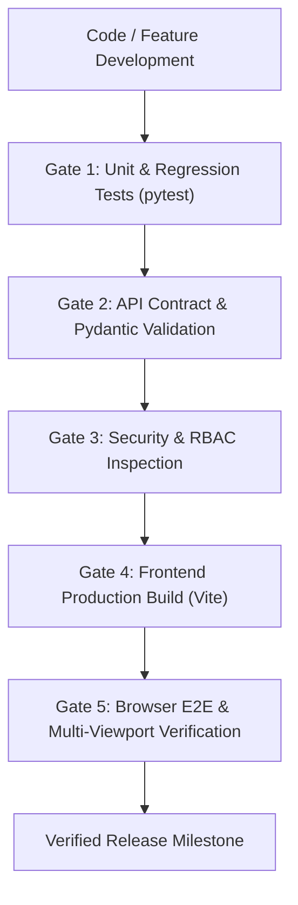

# QUALITY_PLAN.md — Software Quality Assurance & Management Plan

**Project Name:** TRAVELENS — Tourism Destination Review Analyzer  
**Academic Module:** IT Project Management (ITPM)  
**Standard:** ISO/IEC 25010 Software Product Quality Model & IEEE 730 Software Quality Assurance  

---

## 1. Quality Objectives & Quality Policy

The quality policy of the TRAVELENS project mandates that all software deliverables, machine learning models, and architectural components adhere to strict empirical verification, reproducibility, and security standards.

### Core Quality Objectives:
1. **Zero Metric Fabrication:** All metrics presented in documentation and the user interface must originate from actual executed calculations on legitimate benchmark datasets.
2. **Defect-Free Backend:** 100% test pass rate across automated unit, integration, and security test suites ($0\text{ test failures}$).
3. **Clean Production Builds:** Zero compilation or bundling errors during frontend builds (`npm run build`).
4. **Interactive Responsiveness:** Steady-state API response latency for review analysis must remain below $50\text{ ms}$ on local execution.
5. **Architectural Decoupling:** Strict layer independence between presentation, application logic, and data storage.

---

## 2. Quality Metrics & Acceptance Criteria (ISO/IEC 25010)

| Quality Characteristic | Sub-Characteristic | Target Metric | Measured Value | Status |
| :--- | :--- | :--- | :---: | :---: |
| **Functional Suitability** | Functional Completeness | 100% of Blueprint Features (A–J) | 100% Implemented | **MET** |
| **Functional Suitability** | Functional Correctness | 0 failing test cases | 50 / 50 passing | **MET** |
| **Performance Efficiency** | Time Behavior (Warm Latency) | $< 50\text{ ms}$ for ASTMA analysis | $4.78\text{ ms}$ – $17.35\text{ ms}$ | **MET** |
| **Performance Efficiency** | Resource Utilization | Sub-15s frontend bundle build | $11.03\text{ s}$ build time | **MET** |
| **Compatibility** | Co-existence / Portability | Windows, Linux, macOS | Python 3.10+, Node 18+ | **MET** |
| **Usability** | Operability & Accessibility | Responsive layout across 3 viewports | Desktop, Tablet, Mobile verified | **MET** |
| **Reliability** | Fault Tolerance / Robustness | Graceful handling of invalid inputs | HTTP 422 with JSON detail | **MET** |
| **Security** | Confidentiality & Integrity | 0 Critical / High vulnerabilities | Bcrypt 12 rounds, JWT HS256, SQLi proof | **MET** |
| **Maintainability** | Modularity & Reusability | Decoupled 3-tier architecture | Separate frontend/backend/db | **MET** |

---

## 3. Quality Assurance Checkpoints & Stage Gates

1. **Gate 1 (Unit & Regression):** Ran `python -m pytest -v`. 50 tests verified.
2. **Gate 2 (Contract Validation):** Tested payload boundaries with empty and out-of-range payloads.
3. **Gate 3 (Security Inspection):** Probed with SQL injection strings, verified bcrypt hashing and JWT expiration.
4. **Gate 4 (Production Build):** Executed `npm run build` with zero chunk or bundling errors.
5. **Gate 5 (E2E Verification):** Autonomous browser walkthrough verifying complete user journey on desktop, tablet, and mobile.
