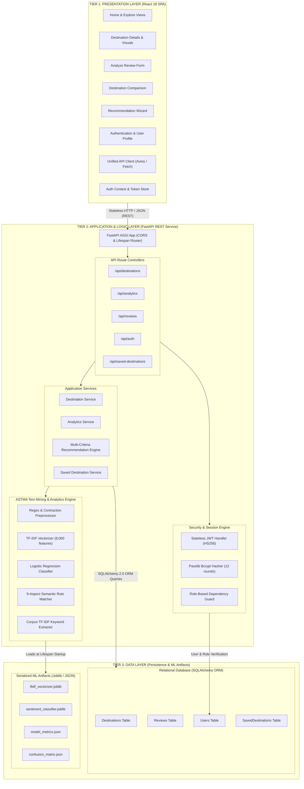

# SYSTEM_ARCHITECTURE.md — TRAVELENS Software Architecture & Component Specification

**System Name:** TRAVELENS — Tourism Destination Review Analyzer  
**Specialization:** Aspect-Sentiment Tourism Mining & Analytics (ASTMA)  
**Architectural Style:** Decoupled 3-Tier Enterprise Systems Architecture (RESTful SOA)  
**Standard:** IEEE 1471 / ISO/IEC 42010 Software Architecture Specification  

---

## 1. High-Level Architectural Overview

TRAVELENS is designed according to the classical **Decoupled 3-Tier Enterprise Architecture**:
1. **Presentation Layer (Tier 1):** Single Page Application (SPA) built with React 18, Vite, Recharts, and a custom editorial Vanilla CSS design system.
2. **Application & Business Logic Layer (Tier 2):** High-performance asynchronous REST API built with Python 3.10+, FastAPI, and Pydantic v2 schemas. Hosts the ASTMA NLP and Machine Learning inference pipelines.
3. **Data Layer (Tier 3):** Relational database managed through SQLAlchemy 2.0 ORM with SQLite (development) and migration support for PostgreSQL (production), alongside serialized Scikit-learn model artifacts.

Communication between Tier 1 and Tier 2 occurs strictly through stateless HTTP/REST endpoints with JSON contracts. Tier 1 has zero knowledge of database schemas, ORM queries, or serialized model binaries.

---

## 2. System Architecture Diagram

---

## 3. Detailed Tier Decomposition

### 3.1 Tier 1: Presentation Layer (React 18 SPA)
- **Framework & Bundler:** React 18, Vite.
- **Routing:** React Router v6 managing 9 distinct views:
  - `Home.jsx` (`/`): Editorial hero, live system counters, curated cards.
  - `Explore.jsx` (`/explore`): Dynamic search, multi-category filtering, responsive cards.
  - `DestinationDetails.jsx` (`/destination/:id`): 9-aspect radar chart, sentiment ring, review lists.
  - `AnalyzeReview.jsx` (`/analyze`): Text mining input, aspect polarity chips, confidence meters.
  - `Compare.jsx` (`/compare`): Side-by-side destination benchmarking across aspect dimensions.
  - `Recommend.jsx` (`/recommend`): Priority weighting sliders, utility score ranking.
  - `Login.jsx` & `Register.jsx`: Auth forms.
  - `Profile.jsx` (`/profile`): User bookmarks and session controls.
  - `About.jsx` (`/about`): Academic methodology and benchmark provenance.
- **Data Visualization:** Built with `recharts` (Radar, Pie, Bar, and Line charts).
- **Styling Paradigm:** Strict Vanilla CSS (`index.css`) utilizing theme tokens for typography (`Playfair Display`, `Plus Jakarta Sans`) and natural editorial palettes (Deep Forest, Terracotta, Warm Sand).

### 3.2 Tier 2: Application Layer (FastAPI)
- **ASGI Router:** FastAPI with lifespan pre-warming.
- **Service Decoupling:**
  - `analytics_service.py`: Computes average ratings, sentiment proportions, aspect averages, and monthly trends.
  - `recommendation_service.py`: Computes weighted utility scores based on user priority vectors:
    $$\text{Score}(d) = \frac{\sum_{i=1}^{9} w_i \cdot s_{d, i}}{\sum_{i=1}^{9} w_i \cdot \mathbb{I}(s_{d, i} \ne \text{null})} \times 100$$
  - `security.py`: Handles password hashing and stateless token issuance.
- **ASTMA ML Engine:**
  - `preprocessor.py`: Regex tokenization, contraction replacement, punctuation stripping, negation token preservation (`not`, `never`, `cannot`).
  - `sentiment_model.py`: Multinomial Logistic Regression classifying texts into `Positive`, `Neutral`, or `Negative`.
  - `aspect_extractor.py`: Rule-based clause segmentation isolating 9 tourism aspects: Attractions, Food, Cleanliness, Price, Crowd, Safety, Transport, Accommodation, Hospitality.
  - `keyword_extractor.py`: Identifies salient destination keyphrases using TF-IDF term weights.

### 3.3 Tier 3: Data Layer (SQLAlchemy ORM & Model Storage)
- **Relational Tables:**
  - `users`: `id`, `username`, `email`, `password_hash`, `is_admin`, `created_at`.
  - `destinations`: `id`, `name`, `country`, `category`, `description`, `image_url`, `tags`, `latitude`, `longitude`.
  - `reviews`: `id`, `destination_id`, `rating`, `review_text`, `sentiment_label`, `sentiment_score`, `created_at`.
  - `saved_destinations`: `id`, `user_id`, `destination_id`, `created_at`.
- **Model Storage:**
  - `tfidf_vectorizer.joblib`: Serialized Scikit-learn vectorizer (8,000 max features, 1-2 n-grams).
  - `sentiment_classifier.joblib`: Serialized Logistic Regression model ($C=1.0$, balanced weights).
  - `model_metrics.json`: Serialized empirical evaluation metrics.

---

## 4. Key Architectural Patterns & Quality Attributes

1. **Decoupled RESTful SOA:** Strict HTTP/JSON protocol ensures presentation can be replaced or extended (e.g. mobile app) without modifying backend logic.
2. **Stateless Scalability:** JWT tokens eliminate sticky-session server dependencies, enabling zero-session-state horizontal scaling.
3. **ORM Parameterization:** Zero string-concatenated SQL queries prevents SQL injection.
4. **Sub-20ms Response Times:** Lifespan pre-warming ensures zero cold-start latency for web requests.
