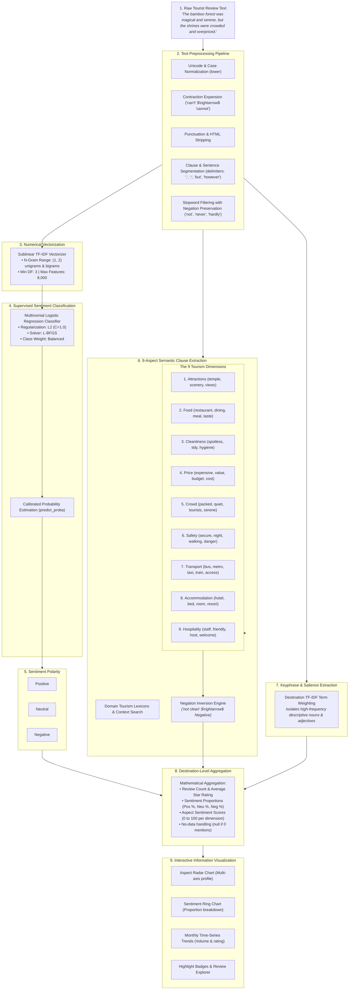

# ASTMA_WORKFLOW.md — Aspect-Sentiment Tourism Mining & Analytics Pipeline

**Specialization:** Aspect-Sentiment Tourism Mining & Analytics (ASTMA)  
**Standard:** Text Mining & Machine Learning Pipeline Architecture  
**Inputs:** Unstructured Natural Language Tourist Reviews  
**Outputs:** 3-Class Sentiment Polarity, Confidence Scores, 9-Aspect Sentiment Ratings, Keyphrases, and Visual Aggregations  

---

## 1. Complete ASTMA Workflow Diagram

---

## 2. Mathematical Pipeline Formulation

### 2.1 Term Frequency-Inverse Document Frequency (TF-IDF)
For term $t$ in review $d$ across corpus $D$:
$$\text{TF}(t, d) = 1 + \ln(f_{t, d}) \quad \text{for } f_{t, d} > 0$$
$$\text{IDF}(t, D) = \ln\left(\frac{1 + |D|}{1 + |\{d \in D : t \in d\}|}\right) + 1$$
$$\text{TF-IDF}(t, d, D) = \text{TF}(t, d) \times \text{IDF}(t, D)$$

### 2.2 Multinomial Logistic Regression Polarity Classifier
For input feature vector $\mathbf{x} \in \mathbb{R}^{8000}$ and class $k \in \{\text{negative}, \text{neutral}, \text{positive}\}$:
$$P(y = k \mid \mathbf{x}) = \frac{\exp(\mathbf{w}_k^T \mathbf{x} + b_k)}{\sum_{j=1}^{3} \exp(\mathbf{w}_j^T \mathbf{x} + b_j)}$$
$$\hat{y} = \arg\max_{k \in \{1, 2, 3\}} P(y = k \mid \mathbf{x})$$

### 2.3 Aspect Polarity Index
For aspect $a \in \{1, \dots, 9\}$ of destination $d$, aggregating $N_{a}$ mentioned clauses:
$$\text{Score}(d, a) = \begin{cases}
\text{null} & \text{if } N_a = 0 \\
\left(\frac{N_{a, \text{pos}} + 0.5 \cdot N_{a, \text{neu}}}{N_a}\right) \times 100 & \text{if } N_a > 0
\end{cases}$$
This ensures destinations with zero review data for a specific aspect are transparently shown as `"No data yet"` rather than falsely penalized with a score of 0/100.
