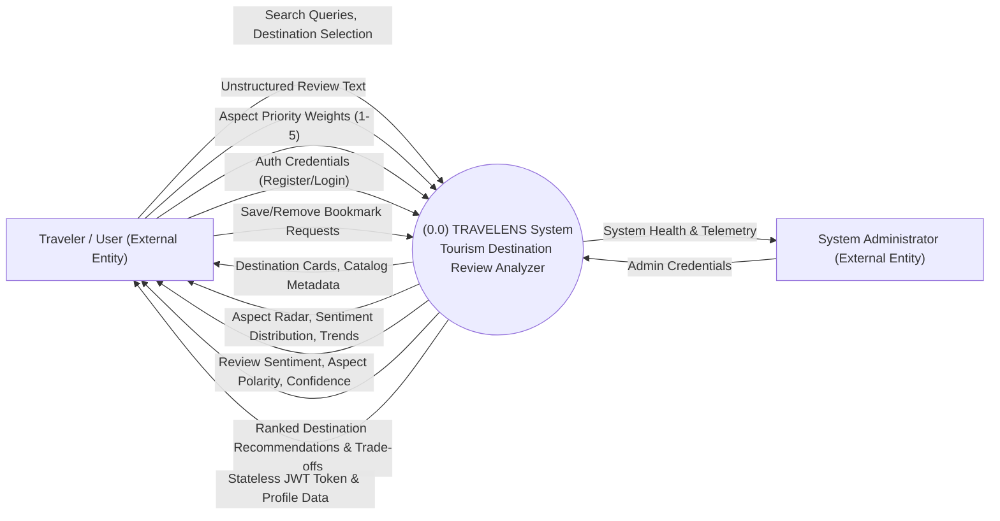
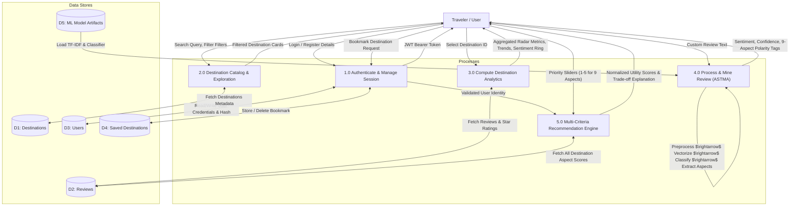

# DFD_DIAGRAMS.md — Data Flow Diagrams (Level 0 and Level 1)

**System Name:** TRAVELENS — Tourism Destination Review Analyzer  
**Standard:** Yourdon & Coad / Gane & Sarson DFD Methodology  
**Verification:** Reflects actual data entities, inputs, transformations, and outputs.

---

## 1. DFD Level 0 — Context Diagram

The Level 0 context diagram defines the boundary of the TRAVELENS system, external entities (User/Traveler and Administrator), and primary data exchanges.

---

## 2. DFD Level 1 — Detailed System Data Flow

The Level 1 DFD decomposes process `0.0` into the five core subsystems, data stores, and internal information flows.

---

## 3. Data Dictionary Summary

| Data Element | Type / Format | Origin | Destination Store / Process | Description |
| :--- | :--- | :--- | :--- | :--- |
| `review_text` | String (Text) | User / Benchmark | Process 4.0 / D2 | Raw tourist review string. |
| `aspect_priorities` | Dict[str, int] | User | Process 5.0 | User importance weights (1–5) across 9 dimensions. |
| `sentiment_label` | String (`positive`, `neutral`, `negative`) | Process 4.0 | D2 / Response | Predicted polarity label from Logistic Regression. |
| `confidence` | Float (0.0 to 1.0) | Process 4.0 | Response | Calibrated probability of the winning sentiment class. |
| `utility_score` | Float (0.0 to 100.0) | Process 5.0 | Response | Weighted multi-attribute score for recommended destination. |
| `jwt_token` | Base64 URL-encoded string | Process 1.0 | User Client | Stateless authentication token containing `sub` claim. |
