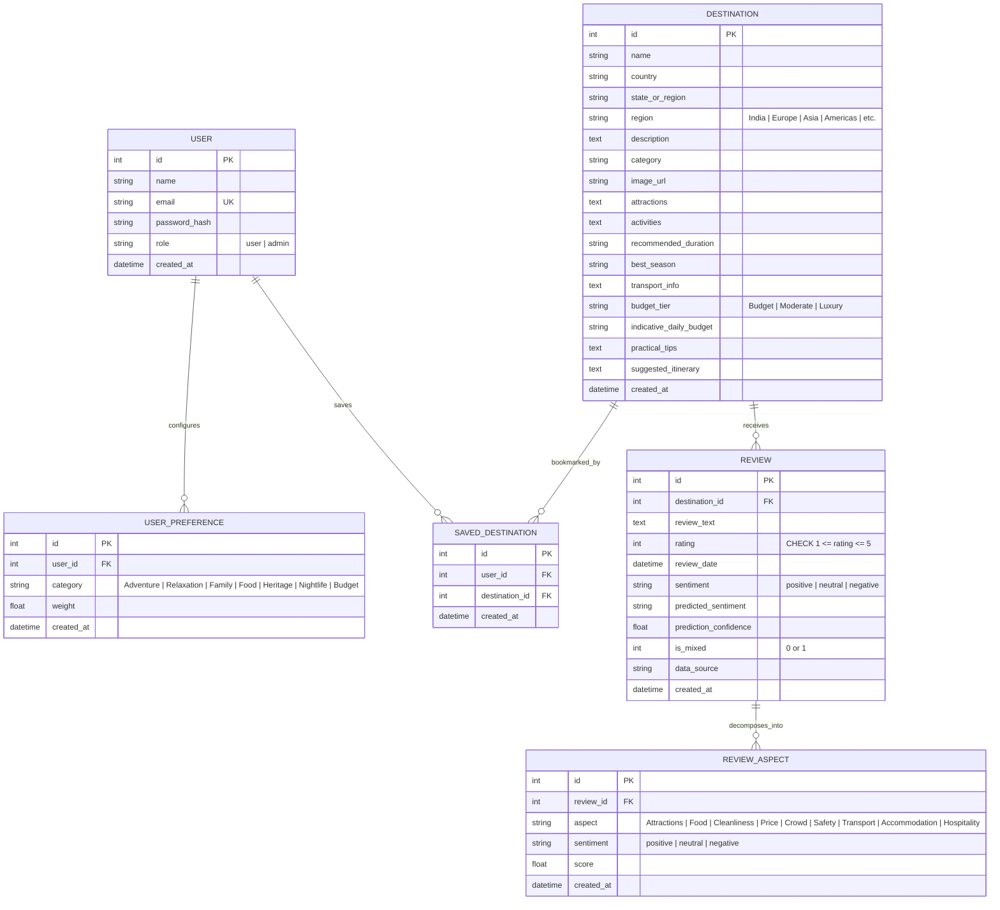

# ER_DIAGRAM.md — Entity-Relationship Specification

**System Name:** TRAVELENS — Tourism Destination Review Analyzer & Trip Planner  
**Data Architecture:** Relational Schema (SQLAlchemy 2.0 ORM Declarative Base)  
**Database Engines:** SQLite (Development) / PostgreSQL (Production)  
**Source File:** [backend/app/db/models.py](file:///c:/Users/tejas/Tourism%20Review/backend/app/db/models.py)  

---

## 1. Entity-Relationship Diagram (Crow's Foot Notation)

---

## 2. Relational Table Specifications & Constraints

### 2.1 `users` Table
- `id` (INTEGER, Primary Key, Auto-increment)
- `name` (VARCHAR(150), NOT NULL)
- `email` (VARCHAR(255), UNIQUE, INDEX, NOT NULL)
- `password_hash` (VARCHAR(255), NOT NULL) — Stored as bcrypt 12-round salted cryptographic string
- `role` (VARCHAR(20), NOT NULL, DEFAULT "user") — RBAC flag ("user" or "admin")
- `created_at` (DATETIME, NOT NULL, DEFAULT CURRENT_TIMESTAMP)

### 2.2 `destinations` Table
- `id` (INTEGER, Primary Key, Auto-increment)
- `name` (VARCHAR(200), INDEX, NOT NULL) — Destination identifier (e.g., "Jaipur", "Kyoto")
- `country` (VARCHAR(100), INDEX, NOT NULL)
- `state_or_region` (VARCHAR(100), NULLABLE)
- `region` (VARCHAR(50), INDEX, NULLABLE) — Region classification (India, Europe, Asia, Americas, Africa, Oceania, Middle East)
- `description` (TEXT, NOT NULL)
- `category` (VARCHAR(50), INDEX, NOT NULL) — Category classification (Heritage, Nature, Coastal, Island, Cultural, Urban, Adventure)
- `image_url` (VARCHAR(500), NULLABLE) — High-resolution photography URL
- `attractions` (TEXT, NULLABLE) — Curated top attractions and landmarks
- `activities` (TEXT, NULLABLE) — Recommended experiences and activities
- `recommended_duration` (VARCHAR(50), NULLABLE) — Suggested stay (e.g. "3–4 days")
- `best_season` (VARCHAR(100), NULLABLE) — Ideal visiting season (e.g. "October to March")
- `transport_info` (TEXT, NULLABLE) — Airport, rail, and local transit logistics
- `budget_tier` (VARCHAR(30), INDEX, NULLABLE) — Standardized tier: "Budget", "Moderate", "Luxury"
- `indicative_daily_budget` (VARCHAR(100), NULLABLE) — Indicative daily budget in USD and INR
- `practical_tips` (TEXT, NULLABLE) — Practical customs, clothing, and ticketing advice
- `suggested_itinerary` (TEXT, NULLABLE) — Structured day-by-day suggested plan
- `created_at` (DATETIME, NOT NULL, DEFAULT CURRENT_TIMESTAMP)

### 2.3 `reviews` Table
- `id` (INTEGER, Primary Key, Auto-increment)
- `destination_id` (INTEGER, Foreign Key $\rightarrow$ `destinations.id`, ON DELETE CASCADE, NOT NULL)
- `review_text` (TEXT, NOT NULL) — Unstructured tourist feedback text
- `rating` (INTEGER, NOT NULL) — Enforces `CHECK (rating >= 1 AND rating <= 5)`
- `review_date` (DATETIME, NOT NULL, DEFAULT CURRENT_TIMESTAMP)
- `sentiment` (VARCHAR(20), NOT NULL) — Ground-truth sentiment mapped from star rating: 4-5 $\rightarrow$ positive, 3 $\rightarrow$ neutral, 1-2 $\rightarrow$ negative
- `predicted_sentiment` (VARCHAR(20), NULLABLE) — Supervised ML classification output ("positive", "neutral", "negative")
- `prediction_confidence` (FLOAT, NULLABLE) — Prediction probability score (0.0 – 1.0)
- `is_mixed` (INTEGER, NOT NULL, DEFAULT 0) — Flag (0 or 1) identifying reviews with contrasting aspect polarities
- `data_source` (VARCHAR(50), NOT NULL, DEFAULT "curated_demonstration_corpus")
- `created_at` (DATETIME, NOT NULL, DEFAULT CURRENT_TIMESTAMP)

### 2.4 `review_aspects` Table
- `id` (INTEGER, Primary Key, Auto-increment)
- `review_id` (INTEGER, Foreign Key $\rightarrow$ `reviews.id`, ON DELETE CASCADE, NOT NULL)
- `aspect` (VARCHAR(50), INDEX, NOT NULL) — One of 9 tourism aspects: Attractions, Food, Cleanliness, Price, Crowd, Safety, Transport, Accommodation, Hospitality
- `sentiment` (VARCHAR(20), NOT NULL) — Polarity for this specific aspect clause ("positive", "neutral", "negative")
- `score` (FLOAT, NOT NULL, DEFAULT 1.0)
- `created_at` (DATETIME, NOT NULL, DEFAULT CURRENT_TIMESTAMP)

### 2.5 `user_preferences` Table
- `id` (INTEGER, Primary Key, Auto-increment)
- `user_id` (INTEGER, Foreign Key $\rightarrow$ `users.id`, ON DELETE CASCADE, NOT NULL)
- `category` (VARCHAR(50), NOT NULL) — Category name
- `weight` (FLOAT, NOT NULL, DEFAULT 1.0) — User importance weight (1.0 to 5.0)
- `created_at` (DATETIME, NOT NULL, DEFAULT CURRENT_TIMESTAMP)

### 2.6 `saved_destinations` Table
- `id` (INTEGER, Primary Key, Auto-increment)
- `user_id` (INTEGER, Foreign Key $\rightarrow$ `users.id`, ON DELETE CASCADE, NOT NULL)
- `destination_id` (INTEGER, Foreign Key $\rightarrow$ `destinations.id`, ON DELETE CASCADE, NOT NULL)
- `created_at` (DATETIME, NOT NULL, DEFAULT CURRENT_TIMESTAMP)

---

## 3. Cardinality & Referential Integrity Summary

- **Destination to Reviews:** $1 : N$ (One destination has zero or many reviews; cascade delete guarantees reviews are purged if destination is removed).
- **Review to ReviewAspects:** $1 : N$ (One review decomposes into zero or many aspect sentiment clauses; cascade delete applies).
- **User to SavedDestinations:** $1 : N$ (One user saves zero or many destinations).
- **Destination to SavedDestinations:** $1 : N$ (One destination is saved by zero or many users).
- **User to UserPreferences:** $1 : N$ (One user defines zero or many category preference weights).
