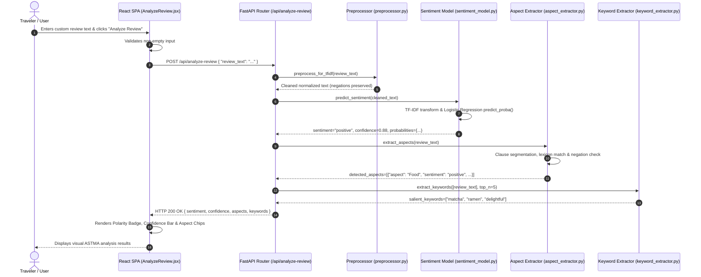
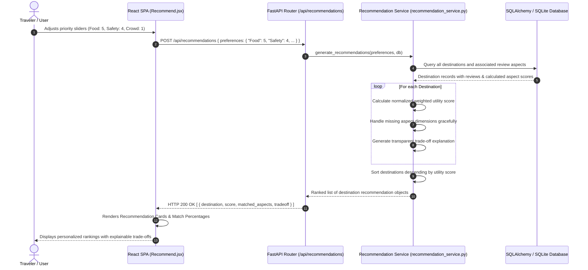

# SEQUENCE_DIAGRAMS.md — System Runtime Interaction Scenarios

**System Name:** TRAVELENS — Tourism Destination Review Analyzer  
**Standard:** UML 2.5 Sequence Diagram Specification  
**Scenarios:** (A) Real-Time Review Analysis, (B) Personalized Recommendation, (C) User Login & JWT Issuance  

---

## 1. Scenario A: Analyze Review (ASTMA Pipeline)

Illustrates the end-to-end runtime lifecycle when a user submits custom review text for real-time aspect and sentiment mining.



---

## 2. Scenario B: Personalized Destination Recommendation

Illustrates multi-attribute utility recommendation formulation based on user priority sliders.



---

## 3. Scenario C: User Login & Stateless JWT Issuance

Illustrates authentication, password verification using bcrypt, and stateless token generation.

```mermaid
sequenceDiagram
    autonumber
    actor User as Traveler / User
    participant UI as React SPA (Login.jsx)
    participant AuthCtx as AuthContext (React)
    participant API as FastAPI Router (/api/auth/login)
    participant Sec as Security Engine (security.py)
    participant DB as SQLAlchemy / SQLite Database

    User->>UI: Enters email and password; clicks "Log In"
    UI->>API: POST /api/auth/login { "email": "...", "password": "..." }

    API->>DB: Query User by email
    alt User Not Found
        DB-->>API: None
        API-->>UI: HTTP 401 Unauthorized ("Invalid credentials")
        UI-->>User: Displays error notification
    else User Exists
        DB-->>API: User record (with password_hash)
        API->>Sec: verify_password(plain_password, password_hash)
        alt Password Hash Mismatch
            Sec-->>API: False
            API-->>UI: HTTP 401 Unauthorized ("Invalid credentials")
            UI-->>User: Displays error notification
        else Password Valid
            Sec-->>API: True
            API->>Sec: create_access_token(data={"sub": user.email, "role": user.role})
            Sec-->>API: Encoded HS256 JWT string (60 min expiry)
            API-->>UI: HTTP 200 OK { "access_token": "...", "token_type": "bearer", "user": {...} }
            UI->>AuthCtx: setToken(access_token) & setUser(user)
            AuthCtx->>AuthCtx: Save token to browser localStorage
            UI-->>User: Redirects to Explore / Profile view as Authenticated
        end
    end
```
