# UML_CLASS_DIAGRAM.md — System Class & Component Architecture

**System Name:** TRAVELENS — Tourism Destination Review Analyzer  
**Standard:** UML 2.5 Class Diagram Specification  
**Focus:** API Controllers, Application Services, ASTMA ML Engine, Database Entities  

---

## 1. UML Class & Module Diagram

```mermaid
classDiagram
    %% API Controllers Layer
    class DestinationRouter {
        +get_destinations(search, category, sort) List~DestinationOut~
        +get_destination(id) DestinationOut
        +get_reviews(id, rating, sentiment, aspect) List~ReviewOut~
    }

    class AnalyticsRouter {
        +get_analytics(id) DestinationAnalyticsOut
        +get_trends(id) List~TrendOut~
        +get_keywords(id) List~KeywordOut~
        +analyze_review(request) ReviewAnalysisOut
        +get_recommendations(request) List~RecommendationOut~
    }

    class AuthRouter {
        +register(user_in) UserOut
        +login(credentials) TokenOut
        +get_current_user() UserOut
    }

    class SavedDestinationsRouter {
        +get_saved(current_user) List~DestinationOut~
        +save_destination(dest_id, current_user) StatusOut
        +remove_saved(dest_id, current_user) StatusOut
    }

    %% Service Layer
    class AnalyticsService {
        +calculate_destination_analytics(dest_id, db) Dict
        +calculate_monthly_trends(dest_id, db) List
        +aggregate_aspect_scores(reviews) Dict
    }

    class RecommendationService {
        +generate_recommendations(preferences, db) List
        +calculate_utility_score(dest_aspects, weights) Float
        +generate_tradeoff_explanation(dest, weights) String
    }

    class SecurityService {
        +verify_password(plain, hashed) Boolean
        +get_password_hash(plain) String
        +create_access_token(data, expires) String
        +get_current_user(token, db) User
        +get_current_admin(user) User
    }

    %% ASTMA ML Engine
    class ASTMAPreprocessor {
        +clean_text(text) String
        +expand_contractions(text) String
        +tokenize_sentences(text) List~String~
        +preprocess_for_tfidf(text) String
    }

    class ASTMASentimentModel {
        -TfidfVectorizer vectorizer
        -LogisticRegression classifier
        +load_model()
        +predict_sentiment(text) Tuple~String, Float, Dict~
    }

    class ASTMAAspectExtractor {
        -Dict aspect_lexicons
        +extract_aspects(text) List~AspectMatch~
        +evaluate_clause_polarity(clause, aspect) String
    }

    class ASTMAKeywordExtractor {
        -TfidfVectorizer vectorizer
        +extract_keywords(texts, top_n) List~Tuple~
    }

    %% Database Models
    class User {
        +int id
        +string name
        +string email
        +string password_hash
        +string role
        +datetime created_at
    }

    class Destination {
        +int id
        +string name
        +string country
        +string description
        +string category
        +string image_url
        +datetime created_at
    }

    class Review {
        +int id
        +int destination_id
        +string review_text
        +int rating
        +string sentiment
        +datetime created_at
    }

    class ReviewAspect {
        +int id
        +int review_id
        +string aspect
        +string sentiment
        +float score
    }

    class SavedDestination {
        +int id
        +int user_id
        +int destination_id
    }

    %% Associations & Dependencies
    DestinationRouter --> AnalyticsService : uses
    AnalyticsRouter --> AnalyticsService : uses
    AnalyticsRouter --> RecommendationService : uses
    AnalyticsRouter --> ASTMASentimentModel : invokes
    AnalyticsRouter --> ASTMAAspectExtractor : invokes
    AnalyticsRouter --> ASTMAKeywordExtractor : invokes
    AuthRouter --> SecurityService : uses
    SavedDestinationsRouter --> SecurityService : uses

    ASTMASentimentModel --> ASTMAPreprocessor : preprocesses with
    ASTMAAspectExtractor --> ASTMAPreprocessor : uses

    AnalyticsService --> Destination : queries
    AnalyticsService --> Review : aggregates
    Review --> Destination : belongs to
    ReviewAspect --> Review : belongs to
    SavedDestination --> User : belongs to
    SavedDestination --> Destination : references
```

---

## 2. Component Responsibility Descriptions

1. **Routers (`backend/app/api/`):**
   - Provide REST API entry points.
   - Deserialize and validate incoming HTTP request payloads via Pydantic schemas.
   - Inject dependencies (database sessions, authentication guards) and delegate to services.
2. **Services (`backend/app/services/`):**
   - Encapsulate domain logic: multi-attribute utility calculation, statistical metric aggregation, password hashing, and token signing.
3. **ASTMA Engine (`backend/app/ml/`):**
   - Handles text mining: regex filtering, contraction expansion, TF-IDF vectorization, Logistic Regression classification, clause-level aspect parsing, and corpus keyphrase extraction.
4. **Data Entities (`backend/app/db/models.py`):**
   - Declarative SQLAlchemy classes mapping application structures directly to relational SQLite/PostgreSQL tables.
