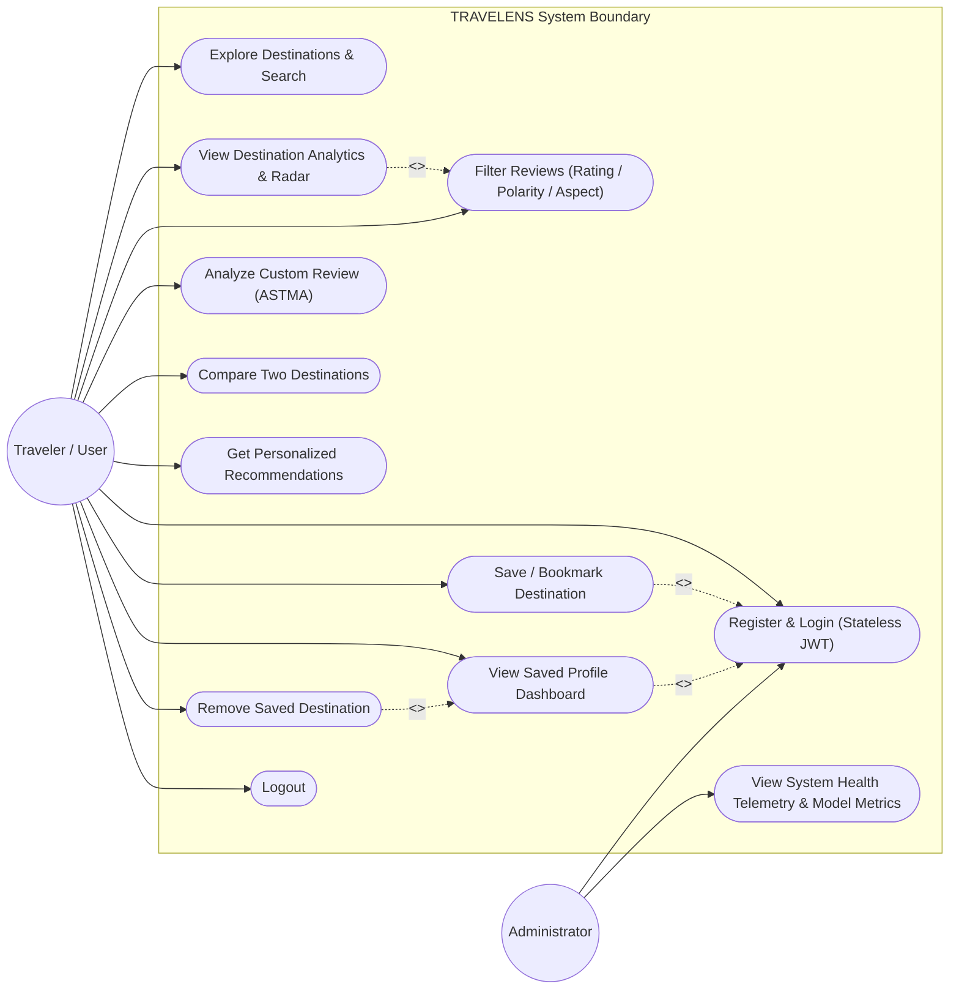

# USE_CASE_DIAGRAM.md — System Use Case Specification

**System Name:** TRAVELENS — Tourism Destination Review Analyzer  
**Standard:** Unified Modeling Language (UML 2.5) Use Case Specification  
**Actors:** Traveler/User (Primary), System Administrator (Secondary)  

---

## 1. Use Case Diagram

---

## 2. Use Case Specifications

| Use Case ID | Name | Primary Actor | Pre-Conditions | Post-Conditions | Main Success Flow |
| :---: | :--- | :--- | :--- | :--- | :--- |
| **UC-01** | Explore Destinations | Traveler | None | Displays destination cards matching criteria | 1. User enters text or filters by category. 2. System filters catalog and renders grid. |
| **UC-02** | View Destination Analytics | Traveler | None | 9-Aspect radar, sentiment ring, and trends rendered | 1. User clicks destination card. 2. System fetches aggregated metrics and draws Recharts. |
| **UC-03** | Filter Reviews | Traveler | Destination page loaded | Review list filtered | 1. User selects star rating, sentiment, or aspect tag. 2. System filters displayed reviews dynamically. |
| **UC-04** | Analyze Custom Review | Traveler | None | ASTMA sentiment and aspect chips displayed | 1. User enters review text. 2. System preprocesses text, predicts sentiment, extracts aspects. 3. System renders polarity badge and confidence. |
| **UC-05** | Compare Destinations | Traveler | None | Side-by-side comparison rendered | 1. User selects Destination A and B. 2. System renders comparative aspect bar chart and trade-offs. |
| **UC-06** | Get Recommendations | Traveler | None | Ranked destinations with explanations shown | 1. User adjusts 1–5 priority sliders for 9 aspects. 2. System computes utility scores and displays rankings. |
| **UC-07** | Register & Login | Traveler / Admin | Valid credentials | JWT access token saved in local store | 1. User enters username/email and password. 2. System verifies bcrypt hash, generates HS256 JWT. |
| **UC-08** | Save Destination | Authenticated User | User logged in | Bookmark saved in database | 1. User clicks bookmark icon on destination. 2. System adds relation in `saved_destinations`. |
| **UC-09** | View Profile | Authenticated User | User logged in | Saved destinations dashboard rendered | 1. User navigates to `/profile`. 2. System fetches all bookmarked destinations. |
| **UC-10** | Remove Saved Destination | Authenticated User | Destination in bookmarks | Bookmark deleted from database | 1. User clicks Remove button on profile card. 2. System deletes record and updates UI instantly. |
| **UC-11** | Logout | Authenticated User | User logged in | Token cleared, unauthenticated state | 1. User clicks Logout button. 2. System clears `token` from `localStorage`. |
| **UC-12** | View Health Telemetry | Administrator | Valid Admin JWT | Server status and metrics verified | 1. Admin accesses health endpoint (`/api/health`). 2. System returns operational status. |
